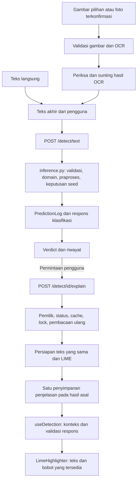

# Panduan Arsitektur dan Integritas Integrasi LIME

Dibuat: **18 November 2026**. Acuan awal: commit `80e3a12` dan perubahan lokal yang diperiksa sesudahnya.

Dokumen ini menjelaskan jalur aktif teks/OCR ke klasifikasi, penjelasan LIME, dan tampilan. Status implementasi dibedakan dari bukti pengujian. VERIDIX mendeteksi kemiripan pola bahasa dengan klaim politik Indonesia yang dilabeli hoaks pada korpus penelitian; hasilnya bukan pembuktian kebenaran berita.

## 1. Acuan dan batas pekerjaan

Aturan kerja tetap pada [AGENTS.md](../AGENTS.md) dan [Panduan Pengembangan AI](PANDUAN_PENGEMBANGAN_AI.md). Kontrak lintas sistem ada di [Referensi Sistem](REFERENSI_SISTEM.md); evaluasi transkripsi di [Panduan Pengujian OCR](PANDUAN_PENGUJIAN_OCR.md); pengambilan foto di [Panduan Kamera dan OCR](PANDUAN_PENGEMBANGAN_KAMERA_OCR.md); kepemilikan/penghapusan data di [Panduan Riwayat](PANDUAN_RIWAYAT.md).

Perbaikan integrasi ini mencakup validasi penjelasan, konteks permintaan, cache/penyimpanan, metadata pemotongan, dan penyajian atribusi. Checkpoint, hash pembanding, tokenizer/config inferensi, praproses yang membentuk masukan model, voting, dataset, dan eksperimen padding tidak diganti.

## 2. Jalur aktif dan berkas yang menjadi sumber



Route diagram disingkat; prefix HTTP aktif adalah `/api/v1`. OCR dan LIME adalah dua permintaan terpisah. Memilih foto atau selesai OCR tidak otomatis membuat klasifikasi maupun LIME.

| Bagian | Sumber aktif / tanggung jawab |
| --- | --- |
| Form dan akun | [NewsInputForm](../frontend/src/components/detector/NewsInputForm.tsx) mengirim teks editor terakhir; [halaman utama](../frontend/src/app/page.tsx) menjaga konteks akun, reset, dan `key` form. |
| Permintaan dan pembatalan | [useDetection](../frontend/src/hooks/useDetection.ts) memakai `apiClient`, ID hasil aktif, generasi permintaan, dan `AbortController`. |
| Kontrak | [Schema backend](../src/api/schemas.py) dan [tipe/parser frontend](../frontend/src/types/detector.ts). |
| HTTP dan penyimpanan | [detection_routes.py](../src/api/routes/detection_routes.py) memeriksa pemilik/status dan menyimpan hasil melalui jalur yang sesuai. |
| Model dan LIME | [inference.py](../src/ml/inference.py), kelas `Penilai`, `BackendIndoBERT`, serta predictor lazy. |
| Praproses | [praproses.py](../src/utils/praproses.py), memakai [text_pipeline.py](../text_pipeline.py) yang identitasnya diperiksa backend. |
| Penyajian | [VerdictCard](../frontend/src/components/detector/VerdictCard.tsx) dan [LimeHighlighter](../frontend/src/components/detector/LimeHighlighter.tsx). |

[inference_service.py](../src/ml/inference_service.py) dan [lime_explainer.py](../src/ml/lime_explainer.py) bukan implementasi yang dipanggil route deteksi aktif pada penelusuran ini. Keberadaan helper tersebut tidak membuktikan aplikasi menerapkan temperature scaling, zona abstain, atau konfigurasi LIME yang tertulis di sana. Jangan memindahkan route ke layanan alternatif sebagai bagian perbaikan UI/integrasi ini.

## 3. Arti teks dan angka

| Field / nilai | Arti dan batas |
| --- | --- |
| `input_text` | Masukan akhir pengguna yang diterima analisis, termasuk hasil suntingan OCR. |
| `teks_dinilai` | Hasil praproses sebelum batas tokenizer. Bukan decoding persis token yang masuk model. Saat ini bukan kolom tersendiri di riwayat. |
| `teks_dijelaskan` | Teks yang diberikan ke LIME, disertakan pada penjelasan baru. Penjelasan cache lama dapat belum memilikinya. |
| `terpotong: true` | Pemotongan diketahui pada praproses kata atau tokenizer. |
| `terpotong: false` | Kedua pengukuran diketahui tidak menunjukkan pemotongan. |
| `terpotong: null` atau metadata lama hilang | Belum cukup informasi untuk menyatakan naskah utuh. UI menampilkan ketidakpastian, tanpa cuplikan 60 kata buatan. |
| `agreement_ratio` | Rasio kesepakatan seed, bukan akurasi atau probabilitas kebenaran. |
| Bobot token LIME | Pengaruh lokal terhadap rerata skor kelas hoaks yang dijelaskan. Bukan bobot kata yang berlaku universal. |
| Confidence OCR | Indikator kepercayaan pengenalan teks; berbeda dari CER/WER maupun kesepakatan model. |

Nilai nol sah dipertahankan. Nilai tidak tersedia, kosong yang sah, penolakan, dan kegagalan tidak disatukan menjadi nol atau sukses.

## 4. Kelayakan teks dan pemotongan

- `Penilai.explain_text` memakai `siapkan_teks`, jalur validasi/persiapan yang sama untuk teks layak. Tidak ada fallback tiga kata untuk mengabaikan kegagalan persiapan.
- Route penjelasan tetap memeriksa kepemilikan dan status hasil `dinilai`/`ambigu`. Data lama yang tidak lagi layak dijelaskan menghasilkan ketidaktersediaan/galat yang terlihat, bukan aturan minimum kedua.
- Diagnostik kata menghitung teks setelah pembersihan yang sama dan opsi penyambungan yang sama, tanpa mengganti hasil praproses untuk inferensi. Kegagalan diagnostik menghasilkan tidak diketahui.
- Penghitungan token dan inferensi menggunakan lock backend yang sama. Hitungan token harus integer nonnegatif, bukan boolean; hitungan hilang/rusak/gagal menghasilkan tidak diketahui.
- Jika salah satu tahap pasti memotong, `terpotong=true`. Jika keduanya pasti tidak memotong, `false`. Keadaan lainnya `null`; kegagalan diagnostik tidak menggagalkan klasifikasi sah.
- Route tidak memakai `bool(...)` untuk metadata pemotongan. Schema, tipe, dan UI menerima nullability yang sama.

Metadata tersebut tidak mengubah checkpoint, masukan inferensi, skor, atau keputusan seed. Teks sesudah batas tokenizer belum disediakan sebagai representasi tersendiri; UI harus menjelaskan batas ini.

## 5. Konteks dan pembatalan frontend

1. Hasil klasifikasi yang diterima mengisi ID aktif. Permintaan LIME hanya memakai ID aktif itu; callback lama tidak mengambil ID cadangan dari closure hasil setelah reset.
2. Setiap permintaan LIME membawa generasi klasifikasi dan controller miliknya. Respons, error, serta finalizer diterima hanya untuk konteks yang masih sesuai.
3. Reset, analisis baru, atau unmount membatalkan permintaan LIME dan menginvalidasi konteks. Perlindungan generasi tetap diperlukan bila transport mengembalikan respons setelah pembatalan, termasuk jika ID hasil terulang pada fixture.
4. Finalizer permintaan lama tidak mematikan loading atau membuka penghalang permintaan baru. Pembaruan state yang dieksekusi React kemudian tetap memeriksa konteks, tanpa bergantung pada controller yang sudah dibersihkan finalizer.
5. Parser respons penjelasan memeriksa envelope sukses, pesan, penjelasan tersedia dengan boolean `true`, array token dengan setidaknya satu kata bernama nonkosong, dan teks penjelasan bila disertakan. Array kosong atau seluruh elemen rusak tidak dianggap penjelasan yang dapat ditampilkan. Payload yang tidak memenuhi kontrak tidak mengganti hasil klasifikasi atau dianggap berhasil.
6. Bobot token tetap disanitasi pada penyajian; token yang sebagian rusak tidak menjadi angka nol. Pemeriksaan envelope bukan jaminan semua bobot/diagnostik valid.
7. Kegagalan penjelasan mempertahankan hasil klasifikasi dan menampilkan sebab yang sesuai. Tidak membuat entri riwayat kedua atau mengirim ulang analisis otomatis.

Pembatalan klien tidak menjamin pekerjaan server yang sudah dimulai ikut berhenti. Pergantian akun tetap memerlukan pemeriksaan identitas backend; guard frontend bukan izin akses database.

## 6. Cache, konkurensi, dan penyimpanan backend

Alur `/explain` pada satu proses:

1. Temukan hasil milik pengguna, periksa status, lalu periksa cache penjelasan.
2. Bila belum tersedia, peroleh lock LIME dengan batas tunggu aktif.
3. Sesudah lock diperoleh, baca ulang record dan periksa cache kembali. Permintaan yang menunggu dapat memakai penjelasan yang sudah disimpan permintaan sebelumnya.
4. Hitung penjelasan jika masih diperlukan; hanya penjelasan dengan `explanation_available is True` yang diterima sebagai tersedia.
5. Simpan pada record asal melalui **satu commit**, lalu lepaskan lock dalam `finally`. Tidak ada blok simpan kedua sesudah pelepasan lock.
6. Galat database di-rollback dan diteruskan ke handler database aplikasi. Kegagalan menghitung/menyimpan tidak mengembalikan respons sukses. Log tambahan tidak menyalin naskah atau pesan exception privat.

Lock ini **per proses**. Tes interleaving tiruan tidak membuktikan deduplikasi lintas worker atau konkurensi PostgreSQL. Jika deployment beberapa worker memerlukan satu komputasi lintas proses, rancang koordinasi database/pekerjaan terpisah dan uji secara nyata.

Pencocokan versi checkpoint/tokenizer/pipeline dengan hasil historis belum tersedia secara lengkap. Cache lama tidak boleh diklaim telah diverifikasi terhadap versi yang sama hanya karena memiliki field penjelasan. Lengkapi identitas versi sebelum menjanjikan reproduksi penjelasan historis; batas ini tetap tercatat pada Referensi Sistem.

## 7. Penyorotan dan konsensus yang jujur

- Pencocokan mempertahankan kapitalisasi serta kata Unicode. `Presiden` dan `presiden` dapat menjadi fitur berbeda dan tidak digabung lewat lowercase.
- Warna mengikuti tanda bobot numerik. Label pengaruh yang bertentangan tidak membalik arah; nol netral, bobot tidak valid tidak diberi angka pengganti.
- Prioritas teks inline adalah teks yang dijelaskan, lalu teks praproses yang tersedia. Jika keduanya hilang pada hasil lama, tampilkan kata atribusi yang tersedia; jangan menempelkan atribusi ke seluruh masukan mentah seolah semuanya dijelaskan.
- Teks praproses tetap diberi batas makna sebelum tokenizer. Kata yang tidak disorot tidak otomatis berarti tidak berpengaruh atau pasti sudah dibaca model.
- `agreement_ratio` tidak diteruskan sebagai `confidenceScore`. Denominator seed tidak diberi angka bawaan. Keputusan seed yang valid dapat membentuk rasio aktual; bila jumlah tidak tersedia, tampilkan persentase kesepakatan yang memang tersedia dengan label yang jelas. Metadata bertentangan dinyatakan tidak konsisten.
- Preferensi grafik/jumlah kata hanya mengubah penyajian. Bobot, fungsi skor LIME, jumlah sampel, dan keputusan model tidak berubah karena preferensi tampilan.

## 8. Pengujian dan batas bukti

Periksa fixture sebelum menjalankan. Gunakan proses Python terpisah untuk fixture route yang men-stub modul inferensi dan tes `Penilai` yang menggunakan modul inferensi sebenarnya dengan backend tiruan. Hindari `unittest discover`, startup/seeding, database pengguna, dan LOCKBOX.

```powershell
node frontend/node_modules/typescript/bin/tsc -p frontend/tsconfig.json --noEmit --incremental false
node --test tests/test_frontend_ocr.cjs tests/test_ocr_hook.cjs tests/test_frontend_guest_access.cjs tests/test_verdict_feedback.cjs tests/test_lime_highlighter.cjs
.\.venv\Scripts\python.exe -B -X utf8 -m unittest tests.test_inference_text_contract tests.test_consensus_metadata tests.test_model_loading -q
.\.venv\Scripts\python.exe -B -X utf8 -m unittest tests.test_lime_routes -q
.\.venv\Scripts\python.exe -B -X utf8 -m unittest tests.test_ocr_routes -q
.\.venv\Scripts\python.exe -B -X utf8 -m unittest tests.test_history_detection_flow -q
```

Skenario regresi yang dicakup meliputi kelayakan teks penjelasan, paritas persiapan input, metadata tidak diketahui, callback/reset, respons terlambat, pembatalan, pembaruan state tertunda, payload penjelasan rusak, kapitalisasi/Unicode, tanda bobot, denominator konsensus, cache setelah menunggu, satu commit, dan rollback.

Hasil eksekusi dicatat pada bagian 9 setelah pemeriksaan selesai. Perintah di atas sendiri bukan bukti lulus. Tes mock/SQLite tidak mengukur kualitas OCR, stabilitas/fidelity LIME, akurasi model, konkurensi database nyata, atau perilaku browser/kamera.

## 9. Status verifikasi dan tindak lanjut

**Verifikasi otomatis pada 18 November 2026 lulus pada perubahan lokal setelah `80e3a12`.** Hasil ini tidak menyatakan browser/kamera, OCR nyata, checkpoint, atau seluruh penelitian sudah final.

| Pemeriksaan yang dijalankan | Hasil | Lingkup bukti |
| --- | --- | --- |
| TypeScript `--noEmit --incremental false` | Lulus | Tipe dan konsistensi nama/path, termasuk footer. |
| Lima suite frontend pada bagian 8 | 112/112 lulus | Renderer/hook/HTTP tiruan, termasuk 18 regresi baru pada hook serta 10 pada highlighter/verdict. |
| `test_inference_text_contract`, `test_consensus_metadata`, `test_model_loading` | 26/26 lulus | Praproses nyata, backend/LIME/loader tiruan; 11 regresi kontrak termasuk batas kata dengan tanda baca akhir. |
| `test_lime_routes` | 11/11 lulus | Handler dengan sesi, lock, dan predictor tiruan; interleaving cache, commit tunggal, rollback, dan nullability. |
| `test_ocr_routes` | 13/13 lulus | HTTP ke aplikasi uji dengan pipeline/model tiruan; tidak membuka mesin OCR. |
| `test_history_detection_flow` | 2/2 lulus | SQLite memori dan klasifikasi tiruan; tidak membuktikan foto atau checkpoint nyata. |

Jumlah tes otomatis di atas **164 lulus**. Pemeriksaan tautan lokal/format dokumen serta whitespace diff juga dilakukan. Peringatan deprecasi Starlette/httpx dan `datetime.utcnow()` masih muncul pada tes Python; ini tidak diubah sebagai bagian integrasi LIME. Tidak ada startup/seeding, database pengguna, atau LOCKBOX yang dijalankan.

Pekerjaan berikutnya yang tetap terpisah:

- Browser dengan akun uji: teks dan foto OCR disunting, analisis sekali, penjelasan pada ID yang sama, pindah akun, lalu cocokkan riwayat setelah reload.
- Pengukuran kualitas foto dengan CER/WER serta pengaruh kesalahan transkripsi pada model, memakai acuan manual dan menghitung penolakan/galat.
- Evaluasi stabilitas/fidelity LIME dan reproduksibilitas terhadap versi artefak yang sesuai protokol.
- Penyimpanan metadata historis dan koordinasi lintas worker bila menjadi kebutuhan deployment.

Dokumen tidak menyatakan semua fitur, penelitian, atau jaminan bebas manipulasi sudah final. Bukti harus menyebut input, revisi kode, lingkungan, pemeriksaan yang dijalankan, hasil buruk/parsial, dan keterbatasannya.
