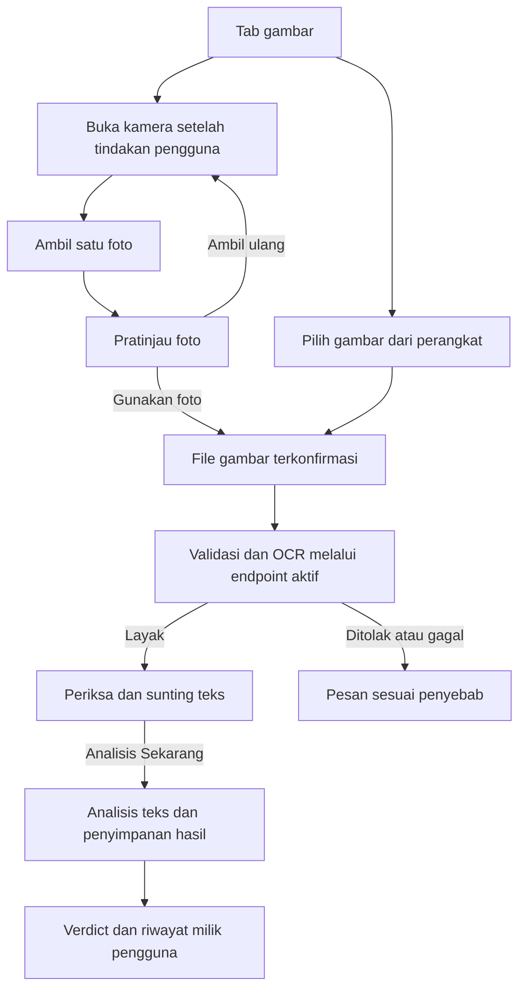

# Panduan Pengembangan Kamera dan OCR VERIDIX

Dibuat: **17 November 2026**. Status diperbarui: **18 November 2026**.

**Status: implementasi dasar kamera dan integrasi form sudah ada; verifikasi kamera/browser serta evaluasi kualitas belum selesai.** Rencana awal mengacu pada commit `088c889`; komponen kamera masuk pada `53f73b3`. Pembaruan integrasi LIME dijelaskan dalam [Panduan Integrasi LIME](PANDUAN_INTEGRASI_LIME.md). Keberadaan komponen bukan bukti bahwa semua kriteria kamera sudah terpenuhi.

Panduan menetapkan alur, batas perubahan, dan bukti penerimaan fitur **Ambil foto**. Dokumen tidak menjamin sistem bebas kesalahan atau manipulasi; aturan harus ditegakkan oleh kode dan pengujian. VERIDIX menganalisis kemiripan pola bahasa dengan klaim politik Indonesia yang dilabeli hoaks pada korpus penelitian. Keluarannya bukan pembuktian kebenaran berita.

## 1. Acuan dan ruang lingkup

Baca [AGENTS.md](../AGENTS.md), [Panduan Pengembangan AI](PANDUAN_PENGEMBANGAN_AI.md), dan [Referensi Sistem](REFERENSI_SISTEM.md). Kebijakan serta metodologi OCR tetap merujuk [Panduan Pengujian OCR](PANDUAN_PENGUJIAN_OCR.md). Persistensi dan kepemilikan riwayat mengikuti [Panduan Riwayat](PANDUAN_RIWAYAT.md); pembagian data mengikuti [protokol penelitian](../PROTOKOL_PRAREGISTRASI.md).

Target awal adalah mengambil **satu foto artikel/paragraf**, memeriksa foto, menjalankan OCR setelah konfirmasi, menyunting teks, lalu menganalisis dan membaca hasil dalam riwayat.

- Pilihan gambar dari perangkat tetap tersedia, termasuk screenshot dan foto yang sudah ada.
- Kamera laptop maupun ponsel menjadi sumber gambar tambahan, tanpa membuat pipeline klasifikasi kedua.
- Pemindaian video terus-menerus, banyak halaman, pembacaan otomatis seluruh koran multikolom, OCR offline, PWA, dan penyimpanan foto permanen berada di luar versi awal.
- Crop, koreksi perspektif, penghilangan bayangan, atau perubahan resolusi OCR menjadi kandidat terpisah jika ada masalah yang terukur.
- Checkpoint, praproses teks, aturan voting/domain, ambang kualitas OCR, dataset, dan eksperimen padding dinamis tidak diubah sebagai bagian penambahan kamera.

## 2. Keadaan kode yang telah dibaca

Tabel ini mencatat pembacaan kode, bukan hasil pengujian kamera atau klaim seluruh perilaku sudah aman.

| Bagian | Keadaan pada pembacaan awal | Implikasi |
| --- | --- | --- |
| [NewsInputForm.tsx](../frontend/src/components/detector/NewsInputForm.tsx) | `handleImageSelect(file)` memvalidasi berkas, membuat preview, dan langsung meminta OCR; form kini menerima hasil dari komponen kamera. | Foto draf diteruskan setelah **Gunakan foto**; pembatalan dan konteks akun perlu diuji. |
| [CameraCapture.tsx](../frontend/src/components/detector/CameraCapture.tsx) | Implementasi pengambilan/pratinjau foto sudah ada. | Aturan lifecycle di bawah adalah kriteria penerimaan; bukan klaim seluruhnya telah dibuktikan. |
| [useDetection.ts](../frontend/src/hooks/useDetection.ts) | `extractTextFromImage` menerima `File` dan sinyal pembatalan, lalu mengirim multipart field `file` lewat `apiClient`. | Gunakan pemanggilan yang sama untuk foto kamera dan gambar pilihan. |
| [Halaman deteksi](../frontend/src/app/page.tsx) | Hook direset saat identitas pengguna berubah; form diberi `key` berdasarkan akun. | Pertahankan pembatas konteks ini dan tambahkan cleanup kamera pada unmount. |
| [Route deteksi](../src/api/routes/detection_routes.py) | `POST /api/v1/detect/image` memerlukan autentikasi dan menjalankan pipeline gambar; respons sukses saat ini berisi `image_url=None`. | Tidak memerlukan endpoint kamera baru; jangan menjanjikan foto dapat dibuka kembali dari riwayat. Autentikasi tetap dapat membaca akun dari database. |
| [Schema API](../src/api/schemas.py) dan [tipe frontend](../frontend/src/types/detector.ts) | Sumber analisis memakai `TEXT` atau `IMAGE`. | Foto kamera tetap dikirim sebagai `IMAGE`; jangan menambahkan enum `CAMERA` sepihak. |
| [ocr_extractor.py](../src/utils/ocr_extractor.py) | Menangani orientasi EXIF, konversi RGB/latar putih, resize lebar maksimal 1400 piksel, dan margin 15 piksel. `OCR_KWARGS` hanya menetapkan `lang="id"`. | EXIF bukan koreksi semua kemiringan/perspektif. Model serta opsi orientasi/pelurusan internal perlu diperiksa dari konfigurasi runtime. |
| [ocr_pipeline.py](../src/utils/ocr_pipeline.py) | Validasi isi/dimensi, pembersihan teks, kategori hasil, gerbang kualitas, dan identitas kebijakan tersedia. | Kamera mengikuti kebijakan yang sama; tidak menyalin pembersihan atau gerbang ke komponen kamera. |
| [requirements.txt](../requirements.txt) | PaddleOCR/PaddlePaddle, Pillow, NumPy, dan `opencv-python-headless` sudah dideklarasikan. | Deklarasi dependensi tidak membuktikan versi terpasang. Tidak ada kebutuhan menambah mesin OCR untuk versi awal. |

Batas pada snapshot: JPEG/PNG/WebP, maksimal **10 MiB** dan **20 juta piksel**; kebijakan OCR mencakup minimal 10 kata, 50 karakter bersih, dan rerata confidence 0,60. Periksa konstanta dan `kebijakan()` aktif sebelum implementasi/evaluasi; angka ini bukan konfigurasi kedua yang boleh berjalan terpisah. MPO dikenali pipeline sebagai varian JPEG, bukan alasan menerima format/MIME sembarang.

`IMAGE` berasal dari payload analisis. Nilai tersebut tidak membuktikan bahwa server menyaksikan kamera atau bahwa OCR dijalankan. Penelusuran asal kamera untuk penelitian menggunakan catatan uji yang jelas; jika perlu disimpan permanen dalam aplikasi, tetapkan perubahan kontrak tersendiri.

## 3. Alur dan batas tanggung jawab yang dituju



Komponen kamera hanya memperoleh gambar dan mengembalikan `File`. Foto baru dikirim untuk OCR setelah **Gunakan foto**. OCR tidak otomatis menjalankan IndoBERT; tombol analisis mengirim teks editor terakhir. Pengiriman, autentikasi, timeout, pembatalan, dan galat HTTP tetap melalui jalur aplikasi yang ada.

IndoBERT menerima teks. Perbedaan fokus, cahaya, kompresi, ukuran huruf, dan urutan baca dapat mengubah bacaan OCR serta masukan model. Kamera yang berhasil dibuka tidak membuktikan foto layak dibaca atau klasifikasi akurat.

## 4. Perilaku UI yang dituju

Di tab gambar sediakan **Pilih gambar** dan **Ambil foto**. Gunakan ikon kamera untuk tindakan memotret; identitas `AIAnalysisIcon` boleh digunakan pada indikator pemrosesan nyata. Teks tombol menjelaskan tindakan pengguna, bukan janji ketepatan model.

| Keadaan | Perilaku yang diperlukan |
| --- | --- |
| Belum masuk / sesi belum terverifikasi | Ikuti penghalang autentikasi yang ada; kamera tidak diminta otomatis. |
| Meminta izin kamera | Status singkat dan tombol tutup/batal tetap tersedia. Jangan membuat persentase progres. |
| Kamera siap | Pratinjau video dan petunjuk singkat agar tulisan memenuhi bingkai, terang, dan tidak terpotong. |
| Frame belum siap | Tombol ambil foto belum aktif; jangan menghasilkan berkas kosong. |
| Foto sudah diambil | Tampilkan foto dengan **Ambil ulang**, **Gunakan foto**, dan **Batal**. Belum ada permintaan OCR. |
| Izin ditolak / kamera tidak ada atau sibuk | Jelaskan sebab yang dapat diketahui, beri tindakan mencoba lagi dan pilihan gambar. |
| Browser/konteks tidak mendukung kamera | Pesan keterbatasan dan pilihan gambar tetap tersedia; bukan kegagalan OCR. |
| Konversi gambar gagal | Tampilkan galat pengambilan foto; jangan meneruskan `null`, berkas kosong, atau foto lama. |
| OCR memproses | Ikuti loading dan pembatas tindakan pada form; cegah tindakan kamera/unggah/analisis yang berkonflik. |
| OCR ditolak / gagal | Bedakan penolakan masukan, mutu, dan galat layanan. Tidak membuat verdict atau entri analisis dari kegagalan OCR. |
| Editor siap | Pengguna memeriksa nama, angka, negasi, serta urutan paragraf sebelum menekan analisis. |

Jika memakai dialog, sediakan nama yang dapat dibaca pembaca layar, fokus keyboard yang dikelola, tombol tutup, pengembalian fokus, serta penanganan Escape. Gunakan `role="status"`/`role="alert"` sesuai pesan, `aria-busy` saat relevan, dan animasi yang mengikuti preferensi pengurangan gerakan.

## 5. Siklus kamera dan keutuhan foto

Rencana teknis utama menggunakan API browser `getUserMedia`, elemen `video`, Canvas, dan hasil `Blob`/`File`. API kamera memerlukan izin dan konteks aman. `localhost` pada laptop berbeda dari alamat LAN yang dibuka melalui HP; pengujian lintas perangkat perlu alamat HTTPS yang dapat dijangkau. Utamakan kamera belakang sebagai **preferensi**, dengan fallback perangkat yang tersedia; jangan mewajibkan kamera belakang pada laptop. Lihat [dokumentasi getUserMedia](https://developer.mozilla.org/en-US/docs/Web/API/MediaDevices/getUserMedia).

1. Minta video dengan `audio: false` setelah tindakan pengguna. Hindari pembukaan ulang kamera otomatis pada render atau perubahan state biasa.
2. Ambil foto setelah video siap dan `videoWidth`/`videoHeight` lebih besar dari nol. Gunakan ukuran frame sebenarnya, bukan ukuran elemen CSS yang meregangkan atau memotong tampilan.
3. Untuk teks, hindari pencerminan horizontal pada foto yang diproses. Bingkai panduan hanyalah petunjuk jika belum ada crop sebenarnya; jangan menampilkan kesan bahwa hanya area bingkai yang dikirim.
4. Ekspor format yang benar-benar didukung backend. Tangani kegagalan `toBlob` dan periksa tipe, ukuran, serta dimensi keluaran; mengganti ekstensi atau MIME saja bukan konversi. Lihat [Canvas toBlob](https://developer.mozilla.org/en-US/docs/Web/API/HTMLCanvasElement/toBlob).
5. Hentikan seluruh track setelah foto berhasil diambil, ketika ditutup/dibatalkan, tab masukan berubah, halaman ditinggalkan, akun berubah, atau komponen unmount. Lepaskan `video.srcObject`. Ambil ulang membuka kamera lagi melalui tindakan pengguna.
6. Jika halaman masuk latar belakang saat kamera terbuka, hentikan stream; minta pengguna membuka lagi saat kembali. Pastikan event/listener dibersihkan.
7. Kaitkan izin kamera dan ekspor foto dengan generasi dialog/konteks. Jika `getUserMedia` baru selesai setelah dialog ditutup atau akun berubah, hentikan stream yang terlambat dan abaikan hasilnya. Menutup dialog tidak otomatis membatalkan janji izin browser.
8. Abaikan callback ekspor foto lama setelah batal/ambil ulang. Cegah klik ganda menghasilkan dua callback **Gunakan foto**.
9. Bebaskan object URL yang dimiliki komponen saat diganti/ditutup. Hindari membebaskan URL milik komponen lain atau URL yang masih dipakai.

`capture="environment"` pada input berkas merupakan alternatif ponsel, dengan perilaku yang bergantung browser/perangkat. Ini tidak menjamin webcam desktop. Jika dipakai nanti, berikan kontrol terpisah agar pilihan gambar biasa tetap ada. Lihat [dokumentasi capture](https://developer.mozilla.org/en-US/docs/Web/HTML/Reference/Attributes/capture).

## 6. Kontrak data, penyimpanan, dan integritas

- Kirim foto terkonfirmasi sebagai multipart field `file` ke `POST /api/v1/detect/image`. Backend tetap memeriksa autentikasi, format/isi, ukuran, dimensi, dan mutu; validasi frontend bukan penggantinya.
- Terima hasil OCR melalui parser/kontrak yang sudah ada. Respons rusak, teks kosong, dan kegagalan layanan tidak diubah menjadi sukses. Confidence `null` dipertahankan sebagai tidak tersedia sesuai kontrak, tanpa diganti nol atau angka buatan. Gerbang mutu mengikuti backend; komponen kamera tidak menambahkan penolakan baru atas respons yang sah.
- Gunakan pembatalan dan pemeriksaan generasi pada form/hook. Respons lama tidak boleh mengisi foto, teks, hasil, atau akun yang baru. Pembatalan HTTP di klien tidak menjamin pekerjaan yang sudah berjalan di server ikut berhenti.
- Pertahankan reset hook dan `key` form berdasarkan akun. Tambahan kamera harus ikut batas konteks tersebut, termasuk stream atau konversi foto yang baru selesai terlambat.
- `POST /api/v1/detect/text` menerima teks editor terakhir dan `input_type: "IMAGE"`. Pertahankan kaitan hasil dengan teks asal, teks yang diproses model, serta informasi pemotongan yang benar-benar tersedia; batasnya ada di Referensi Sistem.
- Endpoint OCR tidak membuat riwayat deteksi. Riwayat analisis dibuat melalui jalur teks; sukses penyimpanan mengikuti konfirmasi server. Nilai model asli tidak ditimpa koreksi/review pengguna atau admin.
- Jangan mengirim URL pratinjau `blob:`/`data:` sebagai alamat gambar permanen. `image_url=None` pada respons aktif tidak boleh diganti alamat buatan atau klaim foto tersimpan. Kebutuhan membuka foto kembali memerlukan desain storage, akses, retensi, dan penghapusan tersendiri.
- Cegah pengiriman ganda pada UI. Jika permintaan analisis timeout atau respons hilang setelah server mungkin menyimpan, jelaskan hasil penyimpanan belum diketahui; jangan mengirim ulang otomatis atau mengklaim tidak ada baris. Idempotensi server lintas retry belum dibuktikan oleh penghalang klik ganda.
- Jangan log stream, frame, base64 foto, naskah privat, token, atau kata sandi. Tidak membuat rekaman video, arsip tersembunyi, atau unggahan latar belakang. Ini persyaratan fitur, bukan pernyataan bahwa seluruh logging aplikasi telah diaudit.
- Simpan minimum data yang diperlukan. Catatan penelitian memakai bahan yang diizinkan dan retensi yang jelas; data kamera/feedback tidak otomatis menjadi data latih.

## 7. Alat yang dipakai dan perubahan yang belum diperlukan

Versi awal memakai API browser dan stack OCR aktif. Library pembungkus kamera dapat dievaluasi jika ada kebutuhan konkret, tetapi bukan syarat. Tidak menambah OCR kedua, layanan OCR berbayar, atau model generatif untuk memperbaiki isi teks.

PaddleOCR menyediakan opsi orientasi dan pelurusan dokumen, tetapi `OCR_KWARGS` saat ini tidak menetapkannya secara eksplisit. Sebelum menambah praproses serupa, catat konfigurasi efektif, model yang terpilih, versi terpasang, dan perilaku runtime. Jangan menyimpulkan fitur internal mati hanya karena tidak terlihat pada wrapper. Lihat [dokumentasi pipeline PaddleOCR](https://www.paddleocr.ai/latest/en/version3.x/pipeline_usage/OCR.html).

OpenCV sudah tercantum pada requirements server. Jika koreksi perspektif diperlukan, gunakan kandidat terpisah dengan perbandingan sebelum/sesudah; OpenCV server berbeda dari OpenCV.js di browser. Kemampuan transformasi tersedia dalam [dokumentasi OpenCV](https://docs.opencv.org/4.x/da/d6e/tutorial_py_geometric_transformations.html), tetapi keberadaan alat tidak menjamin peningkatan OCR.

PWA merupakan rencana lain jika aplikasi perlu dipasang pada layar utama. Kamera tidak memerlukan PWA; pemasangan tidak otomatis membuat OCR, analisis, atau riwayat tersedia offline. Lihat [panduan pemasangan PWA](https://developer.mozilla.org/en-US/docs/Web/Progressive_web_apps/Guides/Making_PWAs_installable).

## 8. Urutan pengerjaan berkas

Tahap berikut membedakan berkas yang sudah tersedia dan pengujian yang masih direncanakan. Periksa status Git dan kode aktif lagi sebelum setiap tahap.

| Tahap | Berkas | Pekerjaan / batas selesai tahap |
| --- | --- | --- |
| 1 | [CameraCapture.tsx](../frontend/src/components/detector/CameraCapture.tsx) — tersedia | Komponen kamera dasar sudah ada; tuntaskan pemeriksaan izin, capture, error, cleanup, dan callback `File` sesuai kriteria. Tidak memanggil OCR/model sendiri. |
| 2 | [NewsInputForm.tsx](../frontend/src/components/detector/NewsInputForm.tsx) | Dua pilihan masukan; setelah konfirmasi, teruskan foto ke `handleImageSelect`. Pertahankan guard login/loading, editor, dan pembatalan. |
| 3 | [Halaman deteksi](../frontend/src/app/page.tsx) dan [useDetection.ts](../frontend/src/hooks/useDetection.ts) | Periksa integrasi konteks akun, reset, dan pemakaian API. Ubah hanya jika ada kebutuhan integrasi yang belum didukung. |
| 4 | `tests/test_camera_capture.cjs` — rencana; tes frontend OCR yang ada | Tambah pengujian lifecycle/race kamera dengan media API tiruan, lalu regresi jalur gambar dan akun. Sesuaikan harness untuk video/Canvas; nama tes baru bukan perintah yang sudah dapat dijalankan. |
| 5 | Browser laptop/HP dan akun uji terisolasi | Uji perangkat nyata, koneksi aman, izin, kualitas foto, OCR, editor, analisis, dan riwayat. |
| 6 | Skrip evaluasi OCR yang ada dan laporan baru | Evaluasi foto berpasangan sesuai bagian 10. Periksa validasi manifest/keluaran runner sebelum batch; jangan menganggap semua kekurangan historis masih sama atau sudah selesai. |
| 7 | Dokumen ini dan sumber utama terkait | Catat revisi, bukti, kegagalan, serta batas perangkat. Perbarui Panduan Pengujian OCR/Referensi Sistem ketika perilaku benar-benar berubah. |

Route/schema/backend OCR tetap menjadi tempat verifikasi kontrak. Jangan mengubahnya untuk sekadar membedakan tombol kamera dan galeri. Perubahan preprocessing atau penyimpanan memerlukan lingkup dan pemeriksaan tersendiri.

## 9. Matriks penerimaan perangkat lunak

Seluruh skenario berikut **belum diuji untuk fitur kamera** saat dokumen dibuat. Kolom bukti menyatakan apa yang perlu dibuktikan, bukan hasil lulus.

| Skenario | Bukti yang diperlukan |
| --- | --- |
| Buka halaman tanpa tindakan | Tidak ada permintaan izin kamera atau OCR otomatis. |
| Tamu/sesi belum terverifikasi | Guard login dipatuhi; backend tetap menolak ekstraksi tanpa autentikasi. |
| Izin ditolak, kamera tidak ada/sibuk, konteks tidak aman | Pesan sesuai kondisi; pilihan gambar masih dapat digunakan. |
| Pengguna membiarkan izin tertunda lalu menutup dialog | UI dapat ditutup; stream yang muncul terlambat langsung dihentikan. |
| Video belum siap / ekspor `Blob` gagal | Tidak mengirim foto kosong, file salah, atau gambar sebelumnya. |
| Ambil foto lalu ambil ulang/batal | Tidak ada OCR sebelum konfirmasi; URL/track lama dilepas. |
| Klik ganda Gunakan foto | Satu penyerahan foto dan satu permintaan OCR pada tindakan tersebut. |
| Tutup, pindah tab/halaman, latar belakang, atau ganti akun | Track dihentikan, listener dibersihkan, callback lama diabaikan. |
| Kamera depan, foto potret, perangkat berbeda | Teks tidak tercermin/terdistorsi; orientasi/dimensi diperiksa. Kamera belakang tidak diwajibkan pada perangkat yang tidak memilikinya. |
| Berkas di luar batas, kosong, rusak, atau format tidak didukung | Penolakan benar; batas frontend dan backend selaras. |
| OCR ditolak, gagal, timeout, atau payload rusak | Tidak muncul teks/verdict/angka pengganti atau data lama sebagai hasil baru. |
| OCR lama selesai setelah gambar/akun berubah | Tidak menimpa konteks baru. |
| OCR lolos dan teks disunting | Payload analisis memakai teks terakhir dan sumber `IMAGE`; hasil/riwayat cocok dengan respons server. |
| Membaca riwayat berulang | Tidak membuat analisis baru atau memanggil ulang model. |
| Klik ganda analisis / hasil penyimpanan tidak diketahui | Pengiriman UI terkendali; timeout tidak menyebabkan klaim penyimpanan atau retry otomatis tanpa kejelasan. |
| Reload dan pemeriksaan akun A/B | Hasil yang dikonfirmasi persisten sesuai pemilik; data akun tidak tertukar. |
| Galeri setelah penambahan kamera | Jalur unggah, preview, editor, dan penolakan yang sebelumnya ada tetap bekerja. |

Untuk tes regresi, gunakan fixture terisolasi dan periksa ulang fixture sebelum menjalankan. Perintah berikut tersedia pada pembacaan awal; **belum dijalankan dalam pembuatan panduan ini**:

```powershell
node frontend/node_modules/typescript/bin/tsc -p frontend/tsconfig.json --noEmit --incremental false
node --test tests/test_frontend_ocr.cjs tests/test_ocr_hook.cjs tests/test_frontend_guest_access.cjs
.\.venv\Scripts\python.exe -B -X utf8 -m unittest tests.test_ocr_routes -q
.\.venv\Scripts\python.exe -B -X utf8 -m unittest tests.test_history_detection_flow -v
```

Jalankan dua perintah Python sebagai proses terpisah. Fixture route menggunakan model/OCR tiruan dan menghindari lifespan/startup aplikasi; integrasi riwayat menggunakan SQLite memori dan klasifikasi tiruan. Tes frontend menggunakan harness/mock. Tes yang ada tidak membuktikan kamera perangkat nyata; lengkapi tes kamera ketika implementasinya tersedia. Jangan memakai seluruh `unittest discover`, database pengguna, seeding, atau LOCKBOX.

## 10. Evaluasi kualitas foto dan dampak ke model

Gunakan kelompok konten yang sama: **gambar digital acuan, foto cetakan, dan transkripsi manual yang diperiksa**. Bila kamera browser dan foto still ponsel dibandingkan, simpan sebagai variasi berbeda. Transkripsi dibuat dengan membaca gambar; jangan menyalin hasil OCR sebagai ground truth.

1. Tetapkan terlebih dahulu cakupan perangkat, jumlah sampel, kondisi, konfigurasi, serta kriteria penerimaan. **Ambang numerik penerimaan CER/WER kamera belum ditetapkan dalam panduan ini.** Putuskan dengan alasan dan data development yang diizinkan sebelum evaluasi penerimaan, bukan setelah memilih hasil yang bagus.
2. Cakup teks jelas, buram, miring, bayangan/pantulan, huruf kecil, tanpa teks, terlalu pendek, dan beberapa kolom. Ambil satu bagian artikel sebagai cakupan awal; jangan mengklaim seluruh koran didukung dari foto satu paragraf.
3. Catat identitas kelompok sumber, perangkat/browser, metode capture, dimensi frame asli, dimensi/format/kompresi file yang dikirim, serta crop/transformasi jika ada. Variasi sumber yang sama tetap dikelompokkan agar tidak bocor antar pembagian data.
4. Jalankan pipeline aktif yang sama. Catat versi/config efektif dan hash kebijakan; jangan mengubah model, ambang, atau praproses di tengah perbandingan tanpa eksperimen terpisah.
5. Ukur CER/WER terhadap acuan sesuai kebijakan pada Panduan Pengujian OCR. Pisahkan bacaan mentah, teks bersih, dan teks suntingan; CER/WER suntingan bukan akurasi OCR otomatis. Periksa khusus nama, angka, negasi, dan urutan paragraf.
6. Bandingkan hasil model pada teks manual, teks OCR bersih, dan teks setelah suntingan melalui jalur inferensi yang sama. Simpan status, input aktual, keluaran/voting yang tersedia, dan pemotongan; catat bila suatu jalur ditolak sehingga model tidak dipanggil. Samanya verdict bukan akurasi terhadap kebenaran klaim.
7. Semua masukan, penolakan, pembatalan yang relevan, dan galat tetap dicatat. Pisahkan jumlah percobaan kamera, foto terkonfirmasi, gambar yang mencapai OCR, dan pasangan yang dapat dibandingkan; tidak menjadikan pembatalan sebelum ada foto sebagai CER/WER nol.
8. Bedakan OCR selesai dengan teks kosong dari input ditolak atau komputasi gagal. Metrik tidak tersedia memakai nilai tidak tersedia beserta alasan. Laporkan hasil seluruh sampel terukur termasuk yang ditolak mutu; rerata hanya pada hasil diterima diberi label bersyarat dan denominator jelas.
9. Ukur latensi kamera/ekspor, OCR, dan inferensi secara terpisah. Ukur beberapa pengulangan dan bedakan cold/warm; jangan mengarang waktu atau progres UI.
10. Kandidat crop/perspektif/resize/kompresi dievaluasi sebelum/sesudah pada sampel yang sama; catat versi kandidat dan kegagalan. Jangan menghapus hasil buruk, mengubah transkripsi mengikuti OCR, memperbaiki isi dengan model generatif, atau menyetel ambang agar semua foto lolos.

Confidence OCR bukan akurasi transkripsi; konsensus seed bukan probabilitas atau akurasi klasifikasi. Label tidak berpola hoaks bukan bukti fakta. Penilaian akurasi klaim memerlukan label referensi yang sah dan rancangan evaluasi sesuai protokol. Evaluasi kamera rutin memakai bahan terisolasi yang diizinkan; tidak membuka LOCKBOX atau mengevaluasi ulang set final.

## 11. Catatan bukti dan kriteria selesai

Gunakan catatan baru untuk tiap putaran. Tentukan jalur laporan yang belum dipakai; jangan menimpa laporan lama atau bahan uji. Catatan tidak memuat kredensial atau naskah privat tanpa dasar dan retensi yang sesuai.

```text
Tanggal dan ID putaran:
Commit / perubahan lokal:
Tahap: statis / mock / browser / OCR nyata / model nyata / database uji:
Perangkat, OS, browser, kamera, dan konteks HTTPS/localhost:
Sumber bahan, izin, manifest, kelompok konten, dan hash gambar:
Pemeriksa transkripsi manual:
Capture: dimensi asli dan dimensi/format/kompresi/transformasi yang dikirim:
Versi terpasang, model/config efektif, dan hash kebijakan OCR:
Identitas artefak serta konfigurasi inferensi:
Kriteria penerimaan dan waktu penetapannya:
Perintah / skenario yang benar-benar dijalankan:
Jumlah percobaan, foto terkonfirmasi, mencapai OCR, ditolak, gagal, terukur:
CER/WER dan denominator; perbedaan raw/bersih/suntingan:
Hasil model manual/OCR/suntingan, penolakan, dan metadata pemotongan:
Latensi per tahap, jumlah pengulangan, dan cold/warm:
Bukti editor, riwayat, konteks akun, serta cleanup kamera:
Kegagalan, keterbatasan, keputusan, dan pekerjaan berikutnya:
Lokasi laporan serta kebijakan retensi:
```

Fitur dapat dinyatakan selesai **pada cakupan perangkat dan penggunaan yang diuji** setelah:

- [ ] Capture, pratinjau, ambil ulang, dan konfirmasi berfungsi; galeri tetap tersedia.
- [ ] Cleanup track/URL/listener, callback terlambat, pembatalan, dan pergantian akun terbukti.
- [ ] Foto terkonfirmasi memakai jalur OCR aktif; penolakan dan kegagalan terlihat dengan benar.
- [ ] Teks editor terakhir, hasil, sumber `IMAGE`, dan riwayat pemilik cocok; tidak ada klaim penyimpanan foto yang belum didukung.
- [ ] Tes yang relevan lulus dengan fixture yang sesuai, lalu browser/kamera nyata diuji secara terpisah.
- [ ] Kriteria kualitas ditetapkan sebelum evaluasi penerimaan dan hasil aktual dilaporkan termasuk kegagalan/penolakan.
- [ ] Tidak ada perubahan algoritma/artefak/data penelitian yang terselip atau hasil buatan sebagai data nyata.
- [ ] Status dan bukti pada dokumen utama diperbarui sesuai implementasi yang benar-benar diperiksa.

Pada pembaruan 18 November 2026, checklist fitur kamera di atas masih **belum dinyatakan terverifikasi seluruhnya**. Keberhasilan tes integrasi LIME tidak mengesahkan checklist kamera. Pemeriksaan dokumen, build, mock, uji perangkat, dan evaluasi kualitas mempunyai cakupan bukti yang berbeda.
