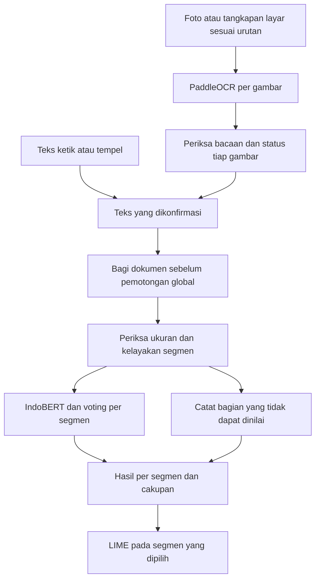

# Rancangan analisis teks panjang dan OCR banyak gambar VERIDIX

Ditulis **18 November 2026** berdasarkan kode pada `65795ee`, analisis yang dilampirkan pengguna, dan hasil uji tersimpan. Mode teks panjang dan antrean banyak gambar di bawah berstatus **usulan untuk diuji**.

Pertahankan jalur analisis singkat sebagai pembanding. Uji mode terpisah yang membagi dokumen sebelum pemotongan global, memakai batas masukan IndoBERT pada **setiap** segmen, lalu menampilkan hasil dan cakupan segmen. Untuk gambar, baca setiap foto dengan PaddleOCR, minta pengguna memeriksa teks dan urutannya, lalu gunakan jalur analisis yang sama. Dengan cara ini, isi setelah kata ke-60 dapat masuk ke segmen berikutnya. Kemampuan model menilai isi tersebut tetap perlu diukur.

## 1. Perilaku saat ini dan bukti

| Bagian | Perilaku yang terlihat pada kode |
| --- | --- |
| Masukan teks | `POST /api/v1/detect/text` menerima teks. Gerbang domain menelusuri naskah penuh, sedangkan praproses classifier mengambil bagian awal. Batas pengaman pada validasi teks saat ini adalah 20.000 karakter setelah sanitasi. [Route](../src/api/routes/detection_routes.py), [validasi](../src/utils/input_validation.py). |
| Praproses | `tp.clean → tp.ensure_end → tp.cap_sentences(60)`. Panjang dapat kurang dari 60 kata ketika pipeline berhenti pada batas kalimat. [Praproses](../src/utils/praproses.py), [pipeline beku](../text_pipeline.py). |
| IndoBERT | Tokenizer membatasi masukan menjadi 128 token termasuk token khusus, dengan padding tetap. Tiga checkpoint seed `42`, `123`, dan `999` menghasilkan suara per masukan. Pada aturan bawaan `unanimous`, `0/3` suara hoaks menghasilkan `TIDAK BERPOLA HOAKS`, `3/3` menghasilkan `BERPOLA HOAKS`, dan hasil lain ambigu. [Inferensi](../src/ml/inference.py). |
| Foto dan OCR | Form berisi satu gambar aktif atau foto kamera. `POST /api/v1/detect/image` menerima satu multipart `file`. PaddleOCR mengekstrak tulisan. Editor menerima `extracted_text` ketika hasil lolos. `Analisis Sekarang` mengirim teks terakhir dari editor sebagai `IMAGE`. [Form](../frontend/src/components/detector/NewsInputForm.tsx), [hook](../frontend/src/hooks/useDetection.ts), [route](../src/api/routes/detection_routes.py). |
| Hasil | `terpotong` menunjukkan pemotongan yang diketahui, ketiadaan pemotongan yang terukur, atau ketidakpastian. `teks_dinilai` adalah teks praproses sebelum batas tokenizer. `image_url` bersifat opsional dan endpoint OCR saat ini mengembalikan `null`. Riwayat menyimpan satu hasil deteksi. [Schema](../src/api/schemas.py), [kartu hasil](../frontend/src/components/detector/VerdictCard.tsx), [model penyimpanan](../src/database/models.py). |
| LIME | Diminta setelah klasifikasi. LIME menjelaskan rerata skor kelas hoaks tiga seed untuk teks yang dijelaskan. Warna menandai arah bobot lokal. Angka 200 adalah jumlah sampel bawaan, termasuk teks asli. [Inferensi](../src/ml/inference.py), [panduan integrasi LIME](PANDUAN_INTEGRASI_LIME.md), [paper LIME](https://arxiv.org/abs/1602.04938). |

Kode pembangunan korpus membentuk teks dari judul dan badan, lalu menerapkan batas maksimal 60 kata pada kedua kelas. Ada ekstraksi klaim khusus untuk sumber `hoax_archive_15k`. Kode tersebut belum cukup untuk menyatakan seluruh kelas fakta hanya berisi paragraf pembuka atau bahwa model dapat menilai paragraf tengah sebaik paragraf pembuka. Ukuran segmen yang sama hanya menyamakan batas panjang. [Pembangunan korpus](../01b_rebuild_dataset_final.py), [pembentukan teks](../text_pipeline.py).

| Bukti | Yang dapat disimpulkan |
| --- | --- |
| Probe lokal 200 kata pada 18 November | Validasi lolos dan praproses menghasilkan 60 kata. Pemuatan dependensi model saat percobaan lokal gagal karena paging file Windows. [Laporan 200 kata](../reports/uji_teks_200_kata_2026-11-18_885d7338.json). |
| Keluaran UI 200 kata yang dilaporkan pengguna | UI menampilkan `0/3` suara hoaks, kesepakatan `3/3`, peringatan pemotongan, dan teks praproses. Hasil tersebut berlaku pada masukan yang diterima classifier. |
| Probe lokal tiga teks 500 kata | Kalimat pada kata ke-21–40 bertahan setelah praproses. Kalimat pada kata ke-241–260 dan ke-481–500 terbuang. Dua kasus terakhir memberi teks praproses yang identik. Percobaan ini mengukur cakupan praproses. [Laporan posisi klaim](../reports/uji_posisi_klaim_500_kata_2026-11-18.json). |
| OCR berpasangan yang tersimpan | Pada U02, transkripsi manual mendapat `0/3` dan bacaan OCR mendapat `2/3`. Kasus itu menunjukkan sensitivitas terhadap kesalahan baca. Akurasi pada foto nyata dan alur banyak gambar memerlukan sampel tambahan. [Panduan Pengujian OCR](PANDUAN_PENGUJIAN_OCR.md). |

Topik “pemilu” dapat berasal dari kata dalam bagian yang terpotong. Karena gerbang domain dan classifier memakai cakupan berbeda, nama topik tidak menunjukkan seberapa banyak dokumen dibaca model. Menaikkan `MAX_LEN` saja masih menyisakan pemotongan yang terjadi pada tahap 60 kata.

## 2. Analisis teks panjang yang diusulkan

**Tahap awal berupa perbaikan pesan.** Di dekat keputusan, tampilkan “Hasil untuk potongan awal naskah. Bagian lain belum dianalisis.” Lengkapi form dengan petunjuk “Tempel klaim atau paragraf yang ingin diperiksa.” Untuk hasil nonhoaks, narasi dapat memakai “Bagian yang dianalisis mendapat label tidak berpola hoaks.” Tampilkan teks praproses dengan keterangan batas tokenizer. Sorotan bagian yang dibaca pada naskah asli memerlukan pemetaan rentang yang dapat dibuktikan. [Form](../frontend/src/components/detector/NewsInputForm.tsx), [kartu hasil](../frontend/src/components/detector/VerdictCard.tsx), [komponen LIME](../frontend/src/components/detector/LimeHighlighter.tsx).

**Kandidat berikutnya berupa mode teks panjang terpisah.** Sumbernya adalah teks utuh yang dikonfirmasi pengguna, termasuk teks editor OCR jika berasal dari gambar. Backend membagi naskah ke segmen, menguji kelayakan masing-masing, lalu menilai segmen yang layak.

1. Pertahankan urutan dan posisi setiap potongan terhadap naskah yang dikonfirmasi. Utamakan batas kalimat atau paragraf. Jika satu kalimat melebihi kapasitas, pecah lanjut dengan konteks yang bertumpang tindih. Pemetaan harus jelas jika sanitasi atau pembersihan menggeser posisi karakter.
2. Pada setiap masukan yang benar-benar akan dikirim, periksa panjang **setelah praproses** dan hitung token dengan tokenizer model tanpa truncation. Batas kandidat awal mengikuti maksimum **60 kata dan 128 token termasuk token khusus**. Jika suatu segmen melampaui batas, pecah kembali. Jika suatu potongan terlalu pendek, coba gabungkan konteks tetangganya selama masih muat. Potongan yang gagal memenuhi syarat diberi status dan alasan. [Dokumentasi tokenizer Transformers](https://huggingface.co/docs/transformers/main_classes/tokenizer).
3. Mulai segmen selanjutnya dari bagian yang belum tercakup, atau dari sedikit konteks sebelumnya selama segmen baru tetap maju. Ukuran tumpang tindih dipilih melalui uji. Hitung cakupan sebagai jumlah kata sumber dalam gabungan rentang yang benar-benar dinilai, dibagi jumlah kata sumber yang dikonfirmasi. Bagian bertumpang tindih dihitung sekali. Jika pemetaan ke sumber belum dapat dipastikan, tampilkan teks yang tersedia dan tandai cakupan sebagai belum diketahui.
4. Jika batas segmen, waktu, memori, atau kelayakan menghalangi pemrosesan lengkap, tampilkan rentang yang belum dinilai. Bedakan segmen direncanakan, segmen dinilai, dan segmen ditolak atau gagal. Jumlah segmen saja tidak cukup untuk menghitung cakupan kata atau karakter.

Pemecah pada lampiran memajukan awal segmen berdasarkan `stride` tanpa memastikan akhir segmen sebelumnya. Uji kode lampiran dengan kalimat sintetis sepanjang **20, 50, dan 10 kata** menghasilkan rentang kata **1–20** dan **71–80**. Sebanyak **50 kata** terlewat. Uji terpisah dengan 13 kalimat masing-masing 60 kata dan `max_segments=12` meninggalkan 60 kata terakhir. Kedua uji memakai operasi string saja. Gunakan pemeriksaan gabungan rentang sebagai kriteria penerimaan, termasuk saat segmen pendek, kalimat panjang, atau batas jumlah segmen tercapai.

### Hasil dan cakupan yang ditampilkan

- Tampilkan status, label pola, dan voting untuk tiap segmen yang dinilai, beserta cuplikan dan posisi asalnya. Segmen di luar domain, ditolak, atau gagal tetap terlihat dengan alasan. Aturan domain per segmen perlu diuji karena lanjutan paragraf dapat bergantung pada konteks atau menyebut subjek secara implisit.
- Gunakan ringkasan seperti **“2 dari 9 segmen yang dinilai berpola hoaks. 1 segmen belum dinilai.”** Angka tersebut hanya contoh tampilan. UI mengambil hitungan dari hasil nyata dan menunjukkan rentang asal. Beri status cakupan parsial jika ada bagian yang belum diproses atau gagal dinilai.
- Hindari satu label dokumen. Kutipan klaim bisa diikuti bantahan. Mengambil skor tertinggi atau satu segmen positif untuk artikel dapat memberi kesan salah. Rerata antarsegmen dapat mengecilkan pengaruh klaim yang singkat. Voting tiga seed tetap berlaku pada segmen masing-masing.
- Hitung LIME hanya ketika pengguna memilih segmen yang berhasil dinilai. Kaitkan penjelasan dengan ID segmen, teks yang dinilai, versi model/pipeline, dan konfigurasi penjelasan. Seluruh artikel yang tercakup secara posisi masih belum membuktikan model menghubungkan konteks antarseksi atau memeriksa fakta.

## 3. Banyak foto dan tangkapan layar yang diusulkan

Jalur kamera saat ini menghasilkan satu `File` setelah pengguna mengonfirmasi foto. Mulai dari daftar beberapa berkas di UI, jalankan **satu permintaan OCR per gambar secara berurutan**, dengan validasi yang sama untuk unggahan dan kamera. Uji dengan 1, 3, 4, dan lebih banyak gambar untuk mendapatkan batas yang sesuai perangkat. Jumlah gambar maksimal, ukuran total, timeout, serta jumlah proses serentak ditentukan dari pengukuran. Menggabungkan hasil OCR dan mengirimnya ke `/detect/text` saat ini tetap menghasilkan potongan awal. Agar halaman berikutnya ikut dinilai, kirim teks yang disetujui ke mode segmentasi ketika mode itu sudah tersedia. [Panduan kamera](PANDUAN_PENGEMBANGAN_KAMERA_OCR.md), [dokumentasi PaddleOCR](https://www.paddleocr.ai/main/en/version3.x/pipeline_usage/OCR.html).

| Kondisi | Perilaku yang dituju |
| --- | --- |
| Foto yang saling melanjutkan | Pengguna memastikan semuanya bagian dokumen yang sama, memeriksa urutan, dan mengoreksi hasil OCR per foto. Gabungkan teks yang disetujui dengan penanda asal halaman di metadata. Masukan classifier tetap berupa isi teks. Segmen dapat melintasi sambungan halaman yang berurutan dan terkonfirmasi, dengan rujukan ke kedua halaman. |
| Foto yang berdiri sendiri | Analisis setiap gambar atau artikel sebagai dokumen terpisah. Pengguna tetap dapat memakai satu antrean OCR dan melihat hasil setiap dokumen. |
| Foto ditolak, kosong, atau layanan gagal | Tampilkan sebab pada foto terkait dan sediakan unggah ulang atau ambil ulang. Simpan pekerjaan yang sudah berhasil pada sesi tersebut. Jika pengguna memilih menganalisis hasil parsial, tandai halaman yang hilang dan jangan merangkai kalimat melintasi celah. |
| Tangkapan layar bertumpuk atau nomor halaman meragukan | Tampilkan preview dan beri pengguna kontrol urutan serta keputusan menghapus duplikasi. Pencocokan otomatis, jika diteliti, perlu memperlihatkan bagian yang dihapus dan menguji risiko menghapus klaim, negasi, atau data penting. |
| Pengguna membatalkan atau mengganti foto | Batalkan request di klien dan abaikan hasil yang terlambat berdasarkan ID foto dan versi permintaan. Komputasi yang sudah dimulai di server dapat tetap berlangsung. Setelah pergantian akun, draf dan respons akun lama tidak masuk ke sesi baru. |

Batas aktif per gambar adalah JPEG/PNG/WebP, 10 MiB dan 20 juta piksel. Gerbang mutu bawaan memeriksa minimal 10 kata, 50 karakter bersih, dan rerata confidence 0,60. Foto pendek, kabur, terpotong, atau dengan urutan kolom sulit dapat membutuhkan pengambilan ulang. Confidence menunjukkan skor pengenalan mesin, sehingga pengguna tetap memeriksa nama, angka, negasi seperti “tidak”, dan urutan bacaan. Guardrail dan IndoBERT bekerja setelah pengguna mengonfirmasi teks. Pemeriksaan keaslian foto dan isi visual di luar tulisan memerlukan metode tersendiri. [Pipeline OCR](../src/utils/ocr_pipeline.py), [ekstraktor](../src/utils/ocr_extractor.py), [pengujian OCR](PANDUAN_PENGUJIAN_OCR.md).

Hook saat ini mengelola satu permintaan OCR aktif. Memanggilnya berkali-kali secara paralel dapat membatalkan permintaan sebelumnya. Karena `null` dikembalikan untuk beberapa jenis kegagalan atau pembatalan, antrean memerlukan hasil yang memuat kategori dan pesan per percobaan. Gunakan ulang kontrak HTTP dan validasi respons yang ada. Progres seperti “3 dari 5 foto selesai dibaca” berasal dari status nyata. Jumlah foto terbaca, cakupan teks hasil edit yang dinilai, dan ketepatan OCR merupakan ukuran berbeda. Foto yang lolos gerbang masih dapat mengandung tulisan yang terlewat. [Hook deteksi](../frontend/src/hooks/useDetection.ts).

## 4. Data dan relasi minimum

Gunakan hubungan **akun → analisis dokumen → segmen → penjelasan** apabila riwayat mode panjang akan disimpan. Untuk jalur gambar, setiap sumber memiliki ID foto dan urutan. Segmen menyimpan referensi rentang yang terbaca dari satu atau lebih sumber. Tabel di bawah menyatakan keperluan kontrak, sementara penamaan field, endpoint, dan penyimpanan ditentukan saat implementasi.

| Entitas | Informasi yang perlu dapat ditelusuri |
| --- | --- |
| Analisis dokumen | Pemilik dari autentikasi server, jenis sumber, versi teks yang dikonfirmasi, status cakupan, identitas konfigurasi dan model, waktu dan hasil aktual yang berhasil disimpan. |
| Sumber foto | ID, posisi, status/galat OCR, urutan yang dikonfirmasi, serta relasi teks ke foto. Catat bahwa pengguna menyunting teks jika perbedaan itu relevan. `IMAGE` saja tidak membuktikan OCR atau kamera benar-benar dipakai. |
| Segmen | ID tetap dalam satu hasil, rentang yang dapat diperiksa, teks yang diteruskan ke model, status, alasan bila gagal, keputusan tiap seed yang tersedia, dan metadata batas kata/token. Gunakan `null` untuk angka yang belum tersedia. |
| Penjelasan | ID segmen dan identitas teks/model/konfigurasi yang dijelaskan. Cache hanya dipakai untuk pasangan yang cocok. Hasil aplikasi lama tetap dibaca sesuai metadata yang tersedia pada hasil tersebut. |

Pada tahap antrean awal, jadikan foto sebagai input sementara dan simpan hasil yang diperlukan sesuai kontrak riwayat. Jika pengguna perlu membuka foto kembali, rancangan itu memerlukan penyimpanan privat, pemeriksaan pemilik, aturan retensi, dan penghapusan data terkait. Hindari menyimpan blob URL sebagai bukti foto tersimpan. Hak akses segmen dan LIME mengikuti pemilik analisis. Laporan penelitian mencatat identitas sampel dan hasil tanpa menyalin foto atau naskah privat ke log teknis. [Panduan Riwayat](PANDUAN_RIWAYAT.md), [Referensi Sistem](REFERENSI_SISTEM.md).

## 5. Uji sebelum dipakai pada sistem utama

Tetapkan ukuran sampel, pemeriksaan, dan kriteria penerimaan sebelum membandingkan konfigurasi. Pemilihan kandidat menggunakan validation yang sesuai atau korpus pengembangan teks panjang terpisah. Gunakan `dev_test` hanya untuk diagnostik sesuai protokol. Kelompokkan segmen, foto, salinan, dan variasi dari dokumen yang sama pada partisi yang sama. Dokumentasikan sumber, label acuan, dan rentang klaim secara independen dari keluaran model. Pisahkan dokumen nyata, sisipan klaim berlabel, serta probe sintetis menurut tujuan uji.

| Uji | Data dan bukti yang diperlukan |
| --- | --- |
| Keutuhan segmentasi | Gunakan teks 200 dan 500 kata, kalimat terlalu panjang, teks tanpa tanda baca, Unicode, batas 128 token, dan batas jumlah segmen. Periksa gabungan rentang, urutan, progres, token yang benar-benar masuk, serta alasan setiap celah. |
| Pengaruh posisi | Bandingkan baseline potongan awal dengan kandidat pada teks yang sama. Pakai klaim berlabel bersumber yang diletakkan di awal, tengah, akhir, dan melintasi batas segmen. Laporkan apakah rentang klaim masuk model dan apakah hasil segmennya berpola hoaks. Dua ukuran ini berbeda. |
| Salah tuduh dan konteks | Gunakan artikel nyata dengan acuan per klaim atau segmen. Sertakan paragraf tengah/akhir yang berbeda dari pembuka, klaim yang dilaporkan sebagai kutipan, negasi, klarifikasi, dan bantahan. Jangan menyalin label sebuah artikel ke semua potongannya tanpa penilaian konteks. Laporkan per posisi dan jenis sumber. |
| Foto nyata dan OCR | Gunakan screenshot dan foto kamera yang berizin, termasuk 4 halaman atau lebih, halaman singkat, kondisi terang/buram/miring, dan kolom ganda. Tetapkan transkripsi manual sebelum melihat hasil OCR. Bandingkan transkripsi manual, bacaan OCR, dan hasil edit yang tercatat sebagai tiga masukan berbeda. Laporkan CER/WER untuk pasangan terukur, tingkat penolakan, perubahan keputusan model, dan perubahan urutan. |
| Pengalaman pengguna dan kegagalan | Uji foto gagal di tengah antrean, pengurutan ulang, duplikasi, pergantian akun, timeout, coba ulang, penyimpanan hasil, dan LIME pada segmen yang benar. Pastikan hasil parsial dan kegagalan terlihat setelah refresh jika riwayatnya didukung. |
| Beban dan paritas | Ukur waktu per OCR, waktu antrean, latensi klasifikasi dan LIME secara terpisah, penggunaan memori serta kegagalan. Dua belas segmen × tiga seed berarti 36 penilaian segmen oleh seed. Jumlah pemanggilan forward bergantung pada batching. Uji kesetaraan keluaran sebelum mengubah batching atau konfigurasi tokenisasi. |

Gunakan pemeriksaan integritas checkpoint dan pipeline selama uji. Simpan data per dokumen dan per segmen, jumlah sampel pada setiap penyebut, hasil buruk/parsial, hash artefak, revisi pipeline, perangkat, dan konfigurasi. Laporkan cakupan dan salah tuduh terpisah dari recall pada klaim berlabel. Setiap celah harus punya alasan yang dapat diperiksa. Catat pilihan konfigurasi, batas beban, dan penyimpangan pada adendum bertanggal sebelum evaluasi final yang relevan. Lockbox lama memiliki tujuan dan aturan tersendiri, termasuk evaluasi per seed serta larangan ensemble. [Protokol penelitian](../PROTOKOL_PRAREGISTRASI.md), [panduan pengembangan](PANDUAN_PENGEMBANGAN_AI.md).

## 6. Urutan pengembangan dan bukti selesai

1. **Cakupan hasil saat ini.** Sesuaikan pesan `NewsInputForm`, `VerdictCard`, dan `LimeHighlighter` supaya pengguna tahu bagian yang diproses dan dapat menguji klaim pilihan. Gunakan metadata dari backend.
2. **Prototipe segmentasi terisolasi.** Uji pemecahan sebelum pemotongan global pada fixture dan tokenizer lokal. Pakai baseline untuk pembanding lalu ukur cakupan, salah tuduh, dan beban dengan checkpoint penelitian. Mode aplikasi baru layak dipertimbangkan setelah kriteria yang ditetapkan tercapai.
3. **Antrean OCR dan editor per gambar.** Bangun alur berurutan dengan endpoint satu gambar yang tersedia. Uji foto nyata dan satu halaman gagal. Kaitkan hasil editor dengan segmen panjang setelah kontraknya terbukti.
4. **Integrasi hasil dan riwayat.** Selaraskan route, schema, tipe UI, dan penyimpanan yang benar-benar dipakai. Tampilkan hasil per segmen dan cakupan pada riwayat. Uji hak akses dan keadaan gagal sebelum mengandalkan hasil untuk laporan penelitian.

Untuk uji awal, jalankan segmentasi dan OCR secara terpisah agar perubahan hasil dapat dilacak sumbernya. Jika kualitas segmen tengah atau akhir belum memenuhi kriteria, jalur pendek dengan batas yang diperlihatkan tetap menjadi pilihan yang telah terdokumentasi. Pekerjaan dokumentasi ini memeriksa kode, laporan tersimpan, dan perilaku pemecah yang diusulkan pada dua fixture string. Evaluasi model panjang, OCR banyak gambar nyata, dan integrasi browser masih menjadi pekerjaan pengujian.
