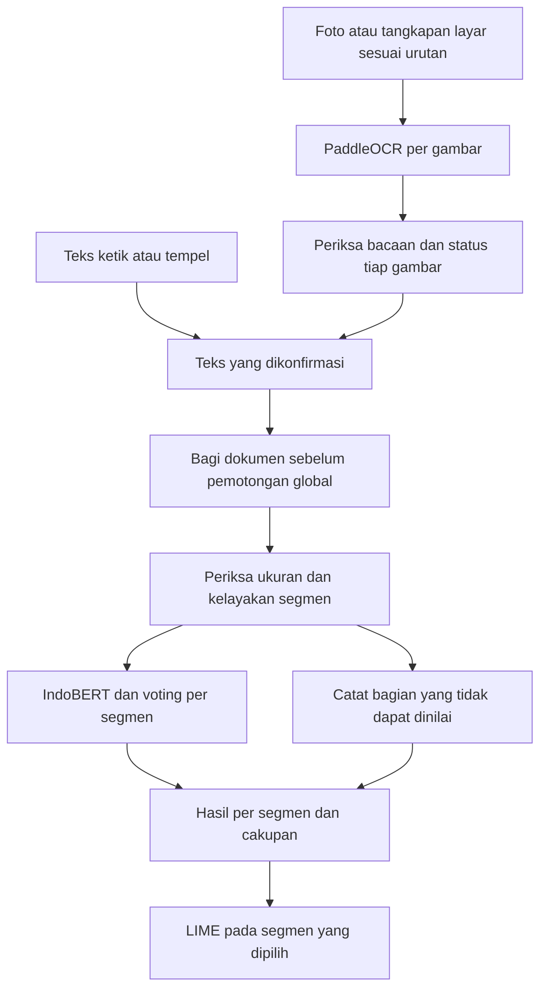

# Analisis teks panjang dan OCR banyak gambar VERIDIX

Ditulis **18 November 2026**. Audit jalur awal merujuk kode pada `65795ee` dan `93b2ca0`. Aplikasi menyediakan **mode analisis naskah eksperimental** dengan hasil per segmen dan antrean OCR banyak foto. Bagian 1.1 mencatat implementasi pilot. Bagian selanjutnya memuat audit jalur singkat dan kebutuhan evaluasi.

## 1. Jalur analisis singkat dan bukti awal

| Bagian | Perilaku yang terlihat pada kode |
| --- | --- |
| Masukan teks | `POST /api/v1/detect/text` menerima teks. Gerbang domain menelusuri naskah penuh, sedangkan praproses classifier mengambil bagian awal. Batas pengaman pada validasi teks saat ini adalah 20.000 karakter setelah sanitasi. [Route](../src/api/routes/detection_routes.py), [validasi](../src/utils/input_validation.py). |
| Praproses | `tp.clean → tp.ensure_end → tp.cap_sentences(60)`. Panjang dapat kurang dari 60 kata ketika pipeline berhenti pada batas kalimat. [Praproses](../src/utils/praproses.py), [pipeline beku](../text_pipeline.py). |
| IndoBERT | Tokenizer membatasi masukan menjadi 128 token termasuk token khusus, dengan padding tetap. Tiga checkpoint seed `42`, `123`, dan `999` menghasilkan suara per masukan. Pada aturan bawaan `unanimous`, `0/3` suara hoaks menghasilkan `TIDAK BERPOLA HOAKS`, `3/3` menghasilkan `BERPOLA HOAKS`, dan hasil lain ambigu. [Inferensi](../src/ml/inference.py). |
| Foto dan OCR | Form berisi satu gambar aktif atau foto kamera. `POST /api/v1/detect/image` menerima satu multipart `file`. PaddleOCR mengekstrak tulisan. Editor menerima `extracted_text` ketika hasil lolos. `Analisis Sekarang` mengirim teks terakhir dari editor sebagai `IMAGE`. [Form](../frontend/src/components/detector/NewsInputForm.tsx), [hook](../frontend/src/hooks/useDetection.ts), [route](../src/api/routes/detection_routes.py). |
| Hasil | `terpotong` menggabungkan pemeriksaan batas kata **setelah pembersihan** dan batas token. Bagian yang dibuang oleh `clean` belum tercakup oleh flag ini. Kartu hasil menampilkan peringatan saat pemotongan diketahui. `teks_dinilai` adalah teks praproses sebelum batas tokenizer. Endpoint OCR mengembalikan `image_url: null`. [Inferensi](../src/ml/inference.py), [kartu hasil](../frontend/src/components/detector/VerdictCard.tsx), [route](../src/api/routes/detection_routes.py). |
| LIME | Diminta setelah klasifikasi. LIME menjelaskan rerata skor kelas hoaks tiga seed untuk teks yang dijelaskan. Warna menandai arah bobot lokal. Angka 200 adalah jumlah sampel bawaan, termasuk teks asli. [Inferensi](../src/ml/inference.py), [panduan integrasi LIME](PANDUAN_INTEGRASI_LIME.md), [paper LIME](https://arxiv.org/abs/1602.04938). |

Kode pembangunan korpus membentuk teks dari judul dan badan, lalu menerapkan batas maksimal 60 kata pada kedua kelas. Ada ekstraksi klaim khusus untuk sumber `hoax_archive_15k`. Kode tersebut belum cukup untuk menyatakan seluruh kelas fakta hanya berisi paragraf pembuka atau bahwa model dapat menilai paragraf tengah sebaik paragraf pembuka. Ukuran segmen yang sama hanya menyamakan batas panjang. [Pembangunan korpus](../01b_rebuild_dataset_final.py), [pembentukan teks](../text_pipeline.py).

| Bukti | Yang dapat disimpulkan |
| --- | --- |
| Probe lokal 200 kata pada 18 November | Validasi lolos dan praproses menghasilkan 60 kata. Pemuatan dependensi model saat percobaan lokal gagal karena paging file Windows. [Laporan 200 kata](../reports/uji_teks_200_kata_2026-11-18_885d7338.json). |
| Keluaran UI 200 kata yang dilaporkan pengguna | UI menampilkan `0/3` suara hoaks, kesepakatan `3/3`, peringatan pemotongan, dan teks praproses. Hasil tersebut berlaku pada masukan yang diterima classifier. |
| Probe lokal tiga teks 500 kata | Kalimat pada kata ke-21–40 bertahan setelah praproses. Kalimat pada kata ke-241–260 dan ke-481–500 terbuang. Dua kasus terakhir memberi teks praproses yang identik. Percobaan ini mengukur cakupan praproses. [Laporan posisi klaim](../reports/uji_posisi_klaim_500_kata_2026-11-18.json). |
| Probe batas kalimat 300 kata | Teks sintetis berisi kalimat 45 kata dan lanjutan 255 kata. `praproses()` menghasilkan 45 kata karena berhenti pada tanda titik dalam jendela awal. Jumlah yang tersisa dan jumlah yang hilang bergantung pada naskah. |
| Probe `Klarifikasi:` | Masukan 31 kata menyusut menjadi 13 dan frasa “tidak pernah” ikut hilang. Pemeriksaan batas kata bernilai `false`. Ketika paragraf `Klarifikasi:` yang sama diberikan sendiri, keluarannya 17 dari 18 kata dan negasi tetap ada. Urutan regex dan posisi penanda terhadap awal segmen memengaruhi hasil. [Pembersihan](../text_pipeline.py), [inferensi](../src/ml/inference.py). |
| OCR berpasangan yang tersimpan | Pada U02, transkripsi manual mendapat `0/3` dan bacaan OCR mendapat `2/3`. Kasus itu menunjukkan sensitivitas terhadap kesalahan baca. Akurasi pada foto nyata dan alur banyak gambar memerlukan sampel tambahan. [Panduan Pengujian OCR](PANDUAN_PENGUJIAN_OCR.md). |

Topik “pemilu” dapat berasal dari kata dalam bagian yang terpotong. Karena gerbang domain dan classifier memakai cakupan berbeda, nama topik tidak menunjukkan seberapa banyak dokumen dibaca model. Menaikkan `MAX_LEN` saja masih menyisakan pemotongan yang terjadi pada tahap 60 kata.

### 1.1 Mode analisis naskah eksperimental di aplikasi

| Bagian | Perilaku pilot |
| --- | --- |
| Pemilihan jalur | Teks ketik atau hasil editor satu foto dengan lebih dari 60 kata masuk mode naskah. Pengguna juga dapat memilih mode naskah untuk teks lebih pendek. Foto dari satu dokumen diproses satu per satu oleh endpoint OCR lalu teks hasil periksa dikirim sebagai halaman. Pengguna dapat menulis transkripsi sendiri saat OCR gagal membaca foto yang valid. |
| Kontrak | `POST /api/v1/detect/document` untuk akun aktif, dengan satu sumber `text` atau daftar berurutan `pages`. Halaman dengan `text: null` dianggap belum tersedia. Batas pilot adalah 4 halaman dan 20.000 karakter Unicode pada teks gabungan. |
| Segmentasi | Periksa gerbang masukan dan domain pada naskah. Bagi teks sumber menurut paragraf dan batas kalimat yang muat, dengan maksimum 60 kata dan 128 token per segmen termasuk token khusus. Segmen memakai rentang berurutan tanpa overlap. Satu kata yang melampaui batas token dicatat sebagai ditolak. |
| Masukan model | Kandidat mengirim rentang sumber ke tokenizer sehingga penanda seperti `Klarifikasi:` dan kalimat sesudahnya tetap masuk. Tokenisasi normal IndoBERT tetap berlaku. Backend mengukur token sebelum inferensi, mematikan truncation, dan memeriksa jumlah token yang masuk. Ambang dan voting seed mengikuti konfigurasi aktif. Penggunaan teks sumber merupakan variasi pipeline yang harus dievaluasi terhadap jalur singkat. |
| Cakupan | Backend mencocokkan rentang karakter Unicode, nomor kata, teks, dan halaman dengan sumber. Segmen yang dinilai dan hasil voting ambigu masuk pembilang. Batas 64 segmen yang dipertimbangkan per permintaan menyisakan rentang eksplisit `belum_dinilai`. Jika halaman kosong atau gagal dibaca, cakupan dokumen tetap parsial dan segmen tidak melintasi celah halaman. |
| Hasil | UI menampilkan status serta label dan voting per segmen yang dinilai. Hasil pilot berada pada sesi aktif. Riwayat, umpan balik, dan LIME untuk segmen memerlukan kontrak serta relasi tersendiri. |

Cakupan lengkap menyatakan seluruh teks sumber yang dikonfirmasi berhasil diproses sesuai rentang. OCR tetap dapat salah baca. Konteks yang melintasi batas segmen dan kualitas keputusan pada paragraf tengah dan akhir masih perlu diuji. Batas jumlah foto dan segmen adalah batas pilot yang perlu ditinjau lewat uji beban.

Uji lokal pada 18 November 2026 dengan tiga checkpoint asli mencakup **500 dari 500 kata sintetis dalam 9 segmen**, termasuk klarifikasi di akhir. Segmen terbesar memakai 65 token. Pada uji API terisolasi, PaddleOCR membaca empat gambar sintetis tanpa selisih kata atau teks setelah spasi diseragamkan. IndoBERT memproses **216 dari 216 kata** dalam empat segmen dengan rujukan halaman 1–4. Uji API mengganti autentikasi dan memakai database SQLite terisolasi. Hasil ini mengukur jalannya sistem dan cakupan pada data sintetis. Kualitas OCR foto nyata dan ketepatan label pada dokumen nyata belum diukur.

[Segmentasi](../src/ml/document_analysis.py) · [Route](../src/api/routes/detection_routes.py) · [Schema](../src/api/schemas.py) · [Form](../frontend/src/components/detector/NewsInputForm.tsx) · [Hasil naskah](../frontend/src/components/detector/DocumentResultCard.tsx).

## 2. Analisis teks panjang yang diusulkan

**Tahap awal berupa perbaikan pesan.** Di dekat keputusan, tampilkan “Hasil untuk potongan awal naskah. Bagian lain belum dianalisis.” Lengkapi form dengan petunjuk “Tempel klaim atau paragraf yang ingin diperiksa.” Untuk hasil nonhoaks, narasi dapat memakai “Bagian yang dianalisis mendapat label tidak berpola hoaks.” Tampilkan teks praproses dengan keterangan batas tokenizer. Sorotan bagian yang dibaca pada naskah asli memerlukan pemetaan rentang yang dapat dibuktikan. [Form](../frontend/src/components/detector/NewsInputForm.tsx), [kartu hasil](../frontend/src/components/detector/VerdictCard.tsx), [komponen LIME](../frontend/src/components/detector/LimeHighlighter.tsx).

**Kandidat berikutnya berupa mode teks panjang terpisah.** Sumbernya adalah teks utuh yang dikonfirmasi pengguna, termasuk teks editor OCR jika berasal dari gambar. Backend membagi naskah ke segmen, menguji kelayakan masing-masing, lalu menilai segmen yang layak.

1. Jadikan teks yang dikonfirmasi sebagai revisi sumber tetap. Bagi revisi itu sebelum pembersihan global yang bisa membuang isi. Utamakan batas kalimat atau paragraf. Uji singkatan, angka desimal, kutipan, baris OCR, dan naskah tanpa tanda baca. Jika satu kalimat terlalu panjang, pecah pada batas kata selama memungkinkan. Jika satu unit tetap melampaui kapasitas, nyatakan rentangnya belum dinilai dan beri alasannya.
2. Pakai pembersihan aktif sebagai baseline untuk tiap kandidat segmen. Periksa batas **sebelum fungsi pemangkasan 60 kata** dan ukur teks yang akan dikirim dengan tokenizer yang sama tanpa truncation, termasuk token khusus. Kandidat awal memakai maksimum **60 kata dan 128 token** per segmen. Pecah ulang bila melebihi kapasitas, lalu pastikan teks yang diukur sama dengan teks yang benar-benar dinilai. Coba gabungkan potongan pendek dengan konteks tetangga dalam batas yang sama. [Dokumentasi tokenizer Transformers](https://huggingface.co/docs/transformers/main_classes/tokenizer).
3. Pilih awal segmen berikutnya dengan melihat posisi akhir segmen terakhir dan kata yang belum tercakup. Awal harus maju tanpa menciptakan celah. Satu kalimat tumpang tindih adalah kandidat jika masih muat dan segmen baru tetap menambah cakupan. Panjang tumpang tindih ditetapkan melalui evaluasi.
4. Jika batas segmen, waktu, memori, atau kelayakan menghalangi pemrosesan lengkap, tampilkan rentang yang belum dinilai. Biarkan pengguna melanjutkan dari rentang yang tersisa pada revisi sumber yang sama jika fitur lanjut tersedia. Gunakan pembatas yang diuji dan pesan yang jelas saat permintaan melampauinya.

Pemecah pada lampiran sebelumnya memajukan awal segmen berdasarkan `stride` tanpa memastikan akhir segmen sebelumnya. Uji kode tersebut dengan kalimat sintetis sepanjang **20, 50, dan 10 kata** menghasilkan rentang kata **1–20** dan **71–80**. Sebanyak **50 kata** terlewat. Uji terpisah dengan 13 kalimat masing-masing 60 kata dan `max_segments=12` meninggalkan 60 kata terakhir. Kedua uji memakai operasi string saja. Gunakan pemeriksaan gabungan rentang sebagai kriteria penerimaan, termasuk saat segmen pendek, kalimat panjang, atau batas jumlah segmen tercapai.

### Bukti cakupan sumber

- Ikat hasil ke ID dan revisi teks yang dikonfirmasi pengguna. Simpan rentang rencana serta rentang sumber yang benar-benar bertahan setelah sanitasi, pembersihan, dan tokenisasi, lalu berhasil dinilai. Gunakan offset karakter Unicode dengan awal berbasis nol dan akhir eksklusif, `[start, end)`, pada revisi sumber. Konversi offset saat memotong string di browser dan uji pemetaan Python–JavaScript pada emoji, karakter gabungan, dan baris baru.
- Catat penghapusan karena pembersihan secara terpisah dari pemotongan batas panjang. Masukkan kasus `Klarifikasi:` di awal dan tengah segmen ke regresi. Memindahkan penanda ke awal segmen dapat mengubah hasil walaupun memakai fungsi yang sama. Uji setiap kandidat pembersihan yang mempertahankan konteks sebagai eksperimen berpasangan, dengan pipeline beku sebagai pembanding.
- Ukur cakupan dari **jumlah kata unik dalam gabungan rentang sumber yang berhasil dinilai ÷ jumlah kata pada sumber yang dikonfirmasi**. Hitung overlap sekali. Segmen ambigu dengan keluaran model sah ikut dalam cakupan. Bagian yang dibuang, ditolak, di luar domain, gagal, atau belum diproses masing-masing memiliki alasan.
- Cakupan **lengkap** memerlukan bukti semua kata sumber telah dinilai. Jika ada rentang yang pasti terlewat, tampilkan **parsial** beserta bagiannya. Tampilkan persentase hanya jika pemetaan dan penyebut dapat dipercaya. Jika cakupan belum bisa ditentukan, tampilkan status **belum diketahui**. Jika semua segmen ditolak atau gagal, tampilkan status tersebut tanpa label atau suara buatan. Status foto yang hilang tetap terlihat meski semua teks hasil OCR yang dikonfirmasi sudah tercakup.

### Hasil dan cakupan yang ditampilkan

- Tampilkan status, label pola, dan voting untuk tiap segmen yang dinilai, beserta cuplikan dan posisi asalnya. Segmen di luar domain, ditolak, atau gagal tetap terlihat dengan alasan. Aturan domain per segmen perlu diuji karena lanjutan paragraf dapat bergantung pada konteks atau menyebut subjek secara implisit.
- Gunakan ringkasan seperti **“2 dari 9 segmen yang dinilai berpola hoaks. 1 segmen belum dinilai.”** Angka tersebut hanya contoh tampilan. UI mengambil hitungan dari hasil nyata dan menunjukkan rentang asal. Beri status cakupan parsial jika ada bagian yang belum diproses atau gagal dinilai.
- Tampilkan satu laporan berisi hasil per segmen dan ringkasan cakupan. Sebuah artikel bisa mengutip klaim lalu membantahnya. Segmen yang tumpang tindih bisa memuat klaim yang sama, sehingga hitungan segmen tidak mengukur jumlah klaim unik. Hindari `vonis_global`, penggabungan suara antarsegmen, atau field `klaim_kunci` yang belum didukung fungsi ekstraksi klaim yang dievaluasi. Jika hasil berbeda antarsegmen, arahkan pengguna membaca bagian terkait. Cakupan lengkap hanya membuktikan bahwa semua bagian telah dinilai, sementara pemahaman konteks lintas segmen perlu diuji tersendiri.
- Hitung LIME saat pengguna memilih segmen yang berhasil dinilai. Ikat penjelasan ke ID segmen, teks yang masuk model, serta versi model, pipeline, dan konfigurasi. LIME memberi pendekatan lokal terhadap skor segmen. Jumlah 200 sampel adalah default aktif. Fidelity, stabilitas, dan latensi ditentukan dari pengukuran. Laporan uji yang ada memuat variasi stabilitas pada empat teks, sehingga klaim waktu 2–3 detik, fidelity terjamin, atau kebutuhan ribuan sampel belum didukung. [Paper LIME](https://arxiv.org/abs/1602.04938), [hasil uji stabilitas](../hasil_stabilitas_lime_20261104_144748_841546.json), [audit latensi bertanggal](../reports/AUDIT_PERFORMA_AI_2026-10-31.md).

## 3. Alur banyak foto dan skenario evaluasi

Jalur kamera menghasilkan satu `File` setelah pengguna mengonfirmasi foto. Antrean banyak foto memakai **satu permintaan OCR per gambar secara berurutan**. Teks yang sudah diperiksa dikirim sebagai daftar halaman ke analisis naskah. Uji dengan 1, 3, dan 4 gambar, serta pastikan unggahan di atas kapasitas ditolak secara jelas. Tinjau kapasitas, timeout, dan jumlah proses serentak dengan pengukuran. [Panduan kamera](PANDUAN_PENGEMBANGAN_KAMERA_OCR.md), [dokumentasi PaddleOCR](https://www.paddleocr.ai/main/en/version3.x/pipeline_usage/OCR.html).

| Kondisi | Perilaku yang dituju |
| --- | --- |
| Foto yang saling melanjutkan | Pengguna memastikan semuanya bagian dokumen yang sama, memeriksa urutan, dan mengoreksi hasil OCR per foto. Gabungkan teks yang disetujui dengan penanda asal halaman di metadata. Masukan classifier tetap berupa isi teks. Segmen dapat melintasi sambungan halaman yang berurutan dan terkonfirmasi, dengan rujukan ke kedua halaman. |
| Foto yang berdiri sendiri | Analisis setiap gambar atau artikel sebagai dokumen terpisah. Pengguna tetap dapat memakai satu antrean OCR dan melihat hasil setiap dokumen. |
| Foto ditolak, kosong, atau layanan gagal | Tampilkan sebab pada foto terkait dan sediakan unggah ulang atau ambil ulang. Simpan pekerjaan yang sudah berhasil pada sesi tersebut. Jika pengguna memilih menganalisis hasil parsial, tandai halaman yang hilang dan jangan merangkai kalimat melintasi celah. |
| Tangkapan layar bertumpuk atau nomor halaman meragukan | Tampilkan preview dan beri pengguna kontrol urutan serta keputusan menghapus duplikasi. Pencocokan otomatis, jika diteliti, perlu memperlihatkan bagian yang dihapus dan menguji risiko menghapus klaim, negasi, atau data penting. |
| Pengguna membatalkan atau mengganti foto | Batalkan request di klien dan abaikan hasil yang terlambat berdasarkan ID foto dan versi permintaan. Komputasi yang sudah dimulai di server dapat tetap berlangsung. Setelah pergantian akun, draf dan respons akun lama tidak masuk ke sesi baru. |

Batas aktif per gambar adalah JPEG/PNG/WebP, 10 MiB dan 20 juta piksel. Gerbang mutu bawaan memeriksa minimal 10 kata, 50 karakter bersih, dan rerata confidence 0,60. Foto pendek, kabur, terpotong, atau dengan urutan kolom sulit dapat membutuhkan pengambilan ulang. Confidence menunjukkan skor pengenalan mesin, sehingga pengguna tetap memeriksa nama, angka, negasi seperti “tidak”, dan urutan bacaan. Guardrail dan IndoBERT bekerja setelah pengguna mengonfirmasi teks. Pemeriksaan keaslian foto dan isi visual di luar tulisan memerlukan metode tersendiri. [Pipeline OCR](../src/utils/ocr_pipeline.py), [ekstraktor](../src/utils/ocr_extractor.py), [pengujian OCR](PANDUAN_PENGUJIAN_OCR.md).

Hook saat ini mengelola satu permintaan OCR aktif. Memanggilnya berkali-kali secara paralel dapat membatalkan permintaan sebelumnya. Karena `null` dikembalikan untuk beberapa jenis kegagalan atau pembatalan, antrean memerlukan hasil yang memuat kategori dan pesan per percobaan. Gunakan ulang kontrak HTTP dan validasi respons yang ada. Progres seperti “3 dari 5 foto selesai dibaca” berasal dari status nyata. Jumlah foto terbaca, cakupan teks hasil edit yang dinilai, dan ketepatan OCR merupakan ukuran berbeda. Foto yang lolos gerbang masih dapat mengandung tulisan yang terlewat. [Hook deteksi](../frontend/src/hooks/useDetection.ts).

Untuk uji empat foto, pakai respons penolakan terkontrol pada foto ketiga untuk memeriksa UI dan coba ulang. Saat menguji foto buram nyata, laporkan hasil yang diberikan PaddleOCR dan gerbang mutu, termasuk jika foto tersebut lolos. Jika halaman ketiga gagal, jalur parsial dapat menganalisis teks halaman 1–2 dan teks halaman 4 sebagai blok yang terpisah. Coba ulang hanya halaman gagal dan pertahankan suntingan yang sudah disetujui pada halaman lain.

## 4. Data dan relasi minimum

Gunakan hubungan **akun → analisis dokumen → segmen → penjelasan** apabila riwayat mode panjang akan disimpan. Untuk jalur gambar, setiap sumber memiliki ID foto dan urutan. Segmen menyimpan referensi rentang yang terbaca dari satu atau lebih sumber. Tabel di bawah menyatakan keperluan kontrak, sementara penamaan field, endpoint, dan penyimpanan ditentukan saat implementasi.

| Entitas | Informasi yang perlu dapat ditelusuri |
| --- | --- |
| Analisis dokumen | Pemilik dari autentikasi server, jenis sumber, versi teks yang dikonfirmasi, status cakupan, identitas konfigurasi dan model, waktu dan hasil aktual yang berhasil disimpan. |
| Sumber foto | ID, posisi, status/galat OCR, urutan yang dikonfirmasi, serta relasi teks ke foto. Catat bahwa pengguna menyunting teks jika perbedaan itu relevan. `IMAGE` saja tidak membuktikan OCR atau kamera benar-benar dipakai. |
| Segmen | ID tetap dalam satu hasil, rentang yang dapat diperiksa, teks yang diteruskan ke model, status, alasan bila gagal, keputusan tiap seed yang tersedia, dan metadata batas kata/token. Gunakan `null` untuk angka yang belum tersedia. |
| Penjelasan | ID segmen dan identitas teks/model/konfigurasi yang dijelaskan. Cache hanya dipakai untuk pasangan yang cocok. Hasil aplikasi lama tetap dibaca sesuai metadata yang tersedia pada hasil tersebut. |
| Feedback | Umpan balik tentang keluaran model merujuk ke ID segmen. Masalah unggahan atau urutan halaman dapat dirujuk ke foto atau dokumen. Kontrak aktif menautkan feedback ke satu `detection_id` dan memiliki batas unik per pengguna dan hasil deteksi. Dukungan feedback per segmen menjadi perubahan kontrak tersendiri. [Model penyimpanan](../src/database/models.py). |

Route LIME aktif membaca `PredictionLog.input_text` berdasarkan ID deteksi. Mode panjang memerlukan kontrak yang memverifikasi bahwa segmen yang diminta milik dokumen dan akun yang sama serta menjelaskan teks segmen yang benar. Hindari mengulang endpoint deteksi dari browser untuk setiap segmen karena tiap panggilan dapat membuat entri riwayat tersendiri. [Route deteksi dan LIME](../src/api/routes/detection_routes.py).

Pada tahap antrean awal, jadikan foto sebagai input sementara dan simpan hasil yang diperlukan sesuai kontrak riwayat. Jika pengguna perlu membuka foto kembali, rancangan itu memerlukan penyimpanan privat, pemeriksaan pemilik, aturan retensi, dan penghapusan data terkait. Hindari menyimpan blob URL sebagai bukti foto tersimpan. Hak akses segmen dan LIME mengikuti pemilik analisis. Laporan penelitian mencatat identitas sampel dan hasil tanpa menyalin foto atau naskah privat ke log teknis. [Panduan Riwayat](PANDUAN_RIWAYAT.md), [Referensi Sistem](REFERENSI_SISTEM.md).

## 5. Uji sebelum dipakai pada sistem utama

Tetapkan ukuran sampel, pemeriksaan, dan kriteria penerimaan sebelum membandingkan konfigurasi. Pemilihan kandidat menggunakan validation yang sesuai atau korpus pengembangan teks panjang terpisah. Gunakan `dev_test` hanya untuk diagnostik sesuai protokol. Kelompokkan segmen, foto, salinan, dan variasi dari dokumen yang sama pada partisi yang sama. Dokumentasikan sumber, label acuan, dan rentang klaim secara independen dari keluaran model. Pisahkan dokumen nyata, sisipan klaim berlabel, serta probe sintetis menurut tujuan uji.

Kolom `body` di header `data/processed_v2/dev_test.csv` tersedia. Kode ekspor mengambilnya dari isi yang sudah dibersihkan, sehingga untuk uji teks panjang perlu memeriksa kelengkapan dan sumber. Pilih artikel asli yang diizinkan, cek judul, sumber, ID atau rujukan, lalu periksa kemungkinan kebocoran terhadap train, termasuk artikel yang sama, salinan dekat, atau klaim yang dikutip ulang. Catat ukuran pilot yang benar-benar diperoleh. Usulan 20–30 artikel adalah contoh ukuran pilot, dengan bukti terbatas untuk generalisasi. [Kode korpus](../01b_rebuild_dataset_final.py), [protokol](../PROTOKOL_PRAREGISTRASI.md).

| Uji | Data dan bukti yang diperlukan |
| --- | --- |
| Keutuhan segmentasi | Uji 200, 300, dan 500 kata, susunan 20+50+10 kata dari lampiran sebelumnya, kalimat panjang, teks tanpa tanda baca, Unicode, batas token 127/128/129 termasuk token khusus, dan batas jumlah segmen. Setiap segmen yang sukses memenuhi kapasitas. Setiap celah punya alasan atau status pemetaan tidak diketahui. |
| Pengaruh posisi | Bandingkan baseline potongan awal dengan kandidat pada teks yang sama. Pakai klaim berlabel bersumber di awal, tengah, akhir, dan melintasi batas segmen. Laporkan berapa klaim unik yang seluruh rentangnya masuk dalam setidaknya satu masukan model dan berapa yang mendapat hasil berpola hoaks pada segmen yang sesuai. Tetapkan aturan pencocokan dengan acuan sebelum uji. Gunakan semua klaim acuan sebagai penyebut utama dan catat kasus terlewat, ditolak, ambigu, atau gagal. |
| Salah tuduh dan konteks | Gunakan artikel nyata dengan acuan per klaim atau segmen. Sertakan paragraf tengah/akhir yang berbeda dari pembuka, klaim yang dilaporkan sebagai kutipan, negasi, klarifikasi, dan bantahan. Jangan menyalin label sebuah artikel ke semua potongannya tanpa penilaian konteks. Laporkan per posisi dan jenis sumber. |
| Foto nyata dan OCR | Gunakan screenshot dan foto kamera yang berizin, termasuk 4 halaman atau lebih, halaman singkat, kondisi terang/buram/miring, dan kolom ganda. Tetapkan transkripsi manual sebelum melihat hasil OCR. Bandingkan transkripsi manual, bacaan OCR, dan hasil edit yang tercatat sebagai tiga masukan berbeda. Laporkan CER/WER untuk pasangan terukur, tingkat penolakan, perubahan keputusan model, dan perubahan urutan. |
| Pengalaman pengguna dan kegagalan | Uji foto gagal di tengah antrean, pengurutan ulang, duplikasi, pergantian akun, timeout, coba ulang, penyimpanan hasil, dan LIME pada segmen yang benar. Pastikan hasil parsial dan kegagalan terlihat setelah refresh jika riwayatnya didukung. |
| Beban dan paritas | Ukur waktu per OCR, waktu antrean, latensi klasifikasi dan LIME secara terpisah, penggunaan memori serta kegagalan. Backend aktif memproses seed bergiliran dan membagi teks ke batch di dalam setiap seed. Dua belas segmen × tiga seed menghasilkan 36 skor segmen–seed. Jumlah pemanggilan forward bergantung pada batching. Uji paritas terhadap jalur tunggal. Ukur beberapa panjang dan jumlah foto pada perangkat sasaran sebelum menentukan batas pemrosesan serta target latensi. [Backend inferensi](../src/ml/inference.py). |

Gunakan pemeriksaan integritas checkpoint dan pipeline selama uji. Simpan data per dokumen dan per segmen, jumlah sampel pada setiap penyebut, hasil buruk/parsial, hash artefak, revisi pipeline, perangkat, dan konfigurasi. Laporkan cakupan dan salah tuduh terpisah dari recall pada klaim berlabel. Setiap celah harus punya alasan yang dapat diperiksa. Catat pilihan konfigurasi, batas beban, dan penyimpangan pada adendum bertanggal sebelum evaluasi final yang relevan. Lockbox lama memiliki tujuan dan aturan tersendiri, termasuk evaluasi per seed serta larangan ensemble. [Protokol penelitian](../PROTOKOL_PRAREGISTRASI.md), [panduan pengembangan](PANDUAN_PENGEMBANGAN_AI.md).

## 6. Urutan pengembangan dan bukti selesai

1. **Cakupan hasil saat ini.** Sesuaikan pesan `NewsInputForm`, `VerdictCard`, dan `LimeHighlighter` supaya pengguna tahu bagian yang diproses dan dapat menguji klaim pilihan. Gunakan metadata dari backend.
2. **Validasi segmentasi pilot.** Uji pemecahan pada fixture dan tokenizer lokal. Pakai baseline sebagai pembanding pada dokumen nyata lalu ukur cakupan, salah tuduh, dan beban dengan checkpoint penelitian.
3. **Validasi OCR dan editor per gambar.** Uji foto nyata, pergantian urutan, dan kegagalan satu halaman. Ukur ketepatan OCR terhadap transkripsi sebelum mengaitkan perubahan skor dengan classifier.
4. **Integrasi hasil dan riwayat berikutnya.** Tetapkan kontrak riwayat per dokumen, hak akses, dan hasil per segmen. Verifikasi penyimpanan serta tautan penjelasan sebelum menampilkannya sebagai fitur.

Jalankan segmentasi dan OCR secara terpisah pada uji awal agar perubahan hasil dapat dilacak. Catat cakupan, penolakan, kegagalan, kualitas, dan latensi sesuai kriteria sebelum eksperimen. Tes perangkat lunak dan probe sintetis memberi bukti kontrak serta cakupan. Evaluasi dokumen nyata dan banyak foto nyata diperlukan untuk menilai kualitas mode ini.
