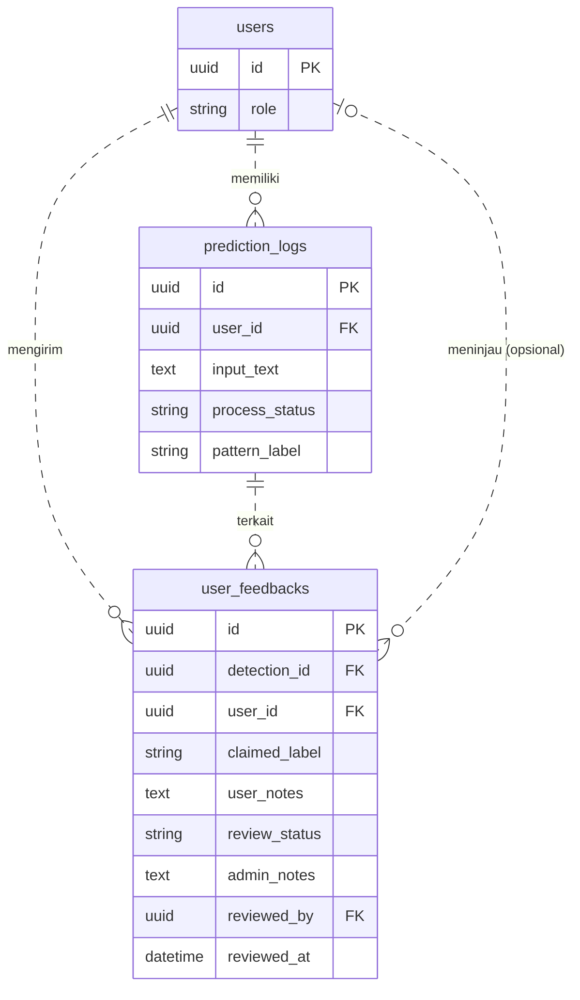

# Referensi Sistem VERIDIX

Pembacaan sumber dan pemisahan dokumen: **13 November 2026**.

Dokumen ini memusatkan arsitektur, kontrak, relasi data, dan batas teknis. Mulai dari [AGENTS.md](../AGENTS.md) untuk aturan wajib, atau [Panduan Pengembangan AI](PANDUAN_PENGEMBANGAN_AI.md) untuk langkah kerja. Pembacaan sumber tidak membuktikan keadaan database produksi, konfigurasi deployment, atau hasil eksekusi.

**Kedudukan isi:** route/schema/model yang disebut sudah dicocokkan dengan berkas sumber saat pembagian. Diagram target, metadata tambahan, riwayat review, identitas cache lengkap, pembatasan beban, dan kebijakan retensi tetap kebutuhan/rencana sampai ada implementasi serta bukti. Catatan audit lama terpisah di [reports](../reports/CATATAN_AUDIT_DOKUMENTASI_2026-11-13.md).

**Navigasi:** [API](#2-inventaris-fitur-dan-kontrak-api), [relasi](#3-relasi-data-dan-kepemilikan), [feedback](#4-siklus-feedback-dan-status-legacy), [masukan](#5-masukan-ocr-dan-pemotongan-teks), [metadata](#6-kegagalan-model-dan-jejak-reproduksi), [LIME](#7-lime-dan-preferensi-tampilan).

Pemeriksaan terarah 16 November 2026 untuk `/admin/users` dan rencana pengembangannya dicatat pada [Panduan Kelola Pengguna](PANDUAN_KELOLA_PENGGUNA.md). Tambahan ini tidak menyatakan seluruh referensi atau database produksi telah diaudit ulang.

## 1. Arsitektur dan batas makna hasil

### 1.1 Komponen sistem

| Komponen | Tanggung jawab |
| --- | --- |
| Frontend | Masukan pengguna, editor OCR, hasil analisis, riwayat, feedback, dan preferensi tampilan. |
| Backend/API | Autentikasi, otorisasi, validasi, koordinasi pemrosesan, dan penyimpanan sesuai kontrak. |
| PaddleOCR | Mengambil teks dari gambar untuk diperiksa pengguna. |
| IndoBERT | Encoder pralatih yang digunakan untuk klasifikasi. Ukuran dan konfigurasi mengikuti artefak yang diverifikasi. |
| Aturan keputusan | Menggabungkan keputusan tiga seed sesuai protokol aktif. |
| LIME | Algoritma penjelasan lokal yang memanggil fungsi prediksi. |
| Database | Menyimpan data akun, hasil, feedback, dan metadata yang didukung schema. |

Jalur yang diperiksa memakai IndoBERT untuk klasifikasi dan LIME untuk penjelasan lokal. Narasi pada komponen hasil merupakan templat; integrasi layanan generatif tidak ditetapkan oleh referensi ini.

Jangan memasukkan LLaMA, Ollama, OpenAI, atau layanan generatif lain ke diagram hanya karena muncul dalam contoh skripsi atau daftar dependensi. Keberadaan paket belum membuktikan penggunaannya pada jalur aktif.

### 1.2 Alur pemrosesan

Diagram berikut adalah alur target. Pemeriksaan identitas versi hasil merupakan kebutuhan integritas, bukan klaim bahwa seluruh metadata dan pemeriksaannya sudah diterapkan. Periksa kode sebelum menyebut suatu bagian aktif.

```mermaid
flowchart LR
    A["Teks langsung"] --> E["Teks terakhir yang diperiksa pengguna"]
    B["Gambar"] --> C["Validasi unggahan dan OCR"]
    C --> D["Editor hasil OCR"] --> E
    E --> F["Pemeriksaan kelayakan"]
    F --> G["Praproses dan tokenisasi"]
    G --> H["IndoBERT: tiga seed"]
    H --> I["Aturan keputusan aktif"]
    I --> J["Hasil dan pencatatan"]
    J --> K["Permintaan penjelasan"]
    K --> L["Pemeriksaan pemilik dan versi hasil"]
    L --> M["LIME dengan fungsi prediksi yang sesuai"]
    M --> N["Sorotan kata dan grafik opsional"]
```



### 1.3 Batas interpretasi

- `TIDAK BERPOLA HOAKS` tidak menjamin kebenaran peristiwa atau klaim berita.
- Kesepakatan seluruh seed bukan probabilitas kebenaran berita.
- Warna merah menunjukkan pengaruh lokal yang menaikkan skor kelas hoaks.
- Warna hijau menunjukkan pengaruh lokal yang menurunkan skor kelas hoaks.
- Bobot LIME bukan persentase kebenaran atau bukti bahwa suatu kata selalu menandai hoaks.
- Penolakan kelayakan masukan harus dibedakan dari kegagalan komputasi model.

Penjelasan ambiguitas harus mengikuti aturan voting aktif. Jangan memakai rentang probabilitas 30%–70% tanpa bukti bahwa aturan tersebut digunakan.

Jika ada ambang pada tahap tertentu, dokumentasikan fungsi dan konfigurasinya. Jangan menyediakan pengubah ambang produksi berdasarkan asumsi UI.

### 1.4 Baseline model dan arti angka

Pembacaan konstanta [inference.py](../src/ml/inference.py) dan [praproses.py](../src/utils/praproses.py) mencatat:

| Unsur | Nilai/perilaku bawaan |
| --- | --- |
| Model dasar | indobenchmark/indobert-base-p1; revisi dipatok pada kode. |
| Checkpoint | CE, seed 42/123/999, dengan pemeriksaan hash. |
| Praproses | tp.clean -> tp.ensure_end -> tp.cap_sentences(60), pipeline tp-1.6. |
| Tokenisasi | max_length 128, padding tetap; batch 32. |
| Keputusan per seed | Hoaks jika probabilitas kelas hoaks >= 0.5. |
| Aturan bawaan | unanimous; VERIDIX_DECISION_RULE dapat mengubah konfigurasi. |
| LIME | Rerata probabilitas kelas hoaks; VERIDIX_LIME_SAMPLES bawaan 200. |

Untuk unanimous: 3/3 menghasilkan BERPOLA HOAKS, 0/3 TIDAK BERPOLA HOAKS, dan 1/3 atau 2/3 berstatus ambigu. LIME menjelaskan rerata probabilitas, bukan langsung fungsi keputusan voting.

agreement_ratio = max(suara_hoaks, jumlah_seed - suara_hoaks) / jumlah_seed. Nilai 1.0 berarti seluruh seed sepakat; nilainya tidak menyatakan probabilitas atau akurasi. Cross-Entropy adalah loss saat pelatihan.

Ini acuan kode, bukan penetapan konfigurasi deployment atau evaluasi model baru. Perubahan artefak, pipeline, voting, tokenisasi, atau sampel LIME memerlukan identitas serta bukti yang sesuai.

## 2. Inventaris fitur dan kontrak API

Prefix bawaan `/api/v1` dibaca dari `src/core/config.py`, dan router didaftarkan melalui `main.py`. Verifikasi konfigurasi deployment serta `baseURL` klien agar prefix tidak terlewat atau ditambahkan dua kali.

Rujukan implementasi yang dibaca:

- `src/api/routes/detection_routes.py`
- `src/api/routes/user_routes.py`
- `src/api/routes/feedback_routes.py`
- `src/api/routes/admin_routes.py`
- `src/api/schemas.py`
- `frontend/src/lib/apiClient.ts`

### 2.1 Route yang ditemukan pada kode

| Kebutuhan | Rujukan kontrak | Pemeriksaan |
| --- | --- | --- |
| Ekstraksi gambar | `POST /api/v1/detect/image` | Autentikasi, unggahan, dan respons OCR; mekanisme penyimpanan gambar perlu diperiksa. |
| Analisis teks/editor OCR | `POST /api/v1/detect/text` | Format body, sumber `TEXT`/`IMAGE`, dan hasil validasi. |
| Penjelasan LIME | `POST /api/v1/detect/{id}/explain` | Pemilik dan kelayakan hasil; pencocokan versi lengkap masih merupakan target integritas. |
| Daftar riwayat | `GET /api/v1/users/history` | Kepemilikan, pagination, dan field respons. |
| Detail/hapus riwayat | `GET`/`DELETE /api/v1/users/history/{id}` | Hak akses dan konsistensi penghapusan. |
| Kirim/perbarui feedback | `POST /api/v1/feedback` | Kepemilikan hasil dan aturan pembaruan. |
| Feedback milik pengguna | `GET /api/v1/feedback/my` | Sesi terverifikasi; query dibatasi `UserFeedback.user_id`, dengan konteks `PredictionLog`. |
| Daftar feedback admin | `GET /api/v1/admin/feedbacks` | Role serta parameter `status_filter`, `skip`, dan `limit`. |
| Review admin | `PUT /api/v1/feedback/{feedback_id}/review` | Status, catatan, reviewer, dan waktu tinjauan. |

Tabel mencatat deklarasi route pada sumber, bukan keberhasilan server/database produksi. Kontrak lengkap riwayat, pagination, detail, dan penghapusan dikelola di [Panduan Riwayat](PANDUAN_RIWAYAT.md); tabel ini hanya inventaris lintas fitur.

### 2.2 Fitur yang perlu dinyatakan ketersediaannya

| Fitur | Ketentuan |
| --- | --- |
| Log global/dashboard admin | Inventarisasi route dan schema aktual; jangan mengarang kontrak. |
| PDF admin | Ada helper ReportLab di source; keberadaan helper tidak membuktikan endpoint/alur ekspor admin sudah terhubung. |
| PDF hasil deteksi | Tombol pada kode yang pernah diperiksa dinonaktifkan; pisahkan dari PDF admin. |
| CSV riwayat | Terdapat fungsi ekspor frontend; cakupan data yang dimuat dijelaskan di [Panduan Riwayat](PANDUAN_RIWAYAT.md). |
| Pengaturan ambang | Utamakan tampilan aturan aktif yang hanya dapat dibaca. |
| Notifikasi feedback | Jangan ditampilkan sebagai layanan aktif sebelum terhubung. |
| Sinkronisasi preferensi cloud | Penyimpanan browser tidak berarti sinkronisasi lintas perangkat. |
| Bahasa Inggris | Pilihan bahasa memerlukan penerjemahan yang benar-benar tersedia. |
| Kelola pengguna admin | Pada pembacaan 16 November 2026, schema/endpoint daftar/status dan hook sudah ada, tetapi tabel masih memakai tiga akun contoh, status lokal, dan alert reset. Integrasi tabel/database belum dibuktikan; lihat [Panduan Kelola Pengguna](PANDUAN_KELOLA_PENGGUNA.md). |

Contoh payload review sesuai schema yang dibaca:

```json
{
  "review_status": "REVIEWED",
  "admin_notes": "Rujukan koreksi telah ditinjau."
}
```

Cocokkan contoh dengan schema aktual. Nama `status`, `review_notes`, atau nilai `MARKED_FOR_RETRAIN` tidak menjadi kontrak sah hanya karena dipakai frontend.

### 2.3 Kelola pengguna: implementasi saat diperiksa dan target

Jalur sumber yang diperiksa pada 16 November 2026: [halaman admin pengguna](../frontend/src/app/admin/users/page.tsx) memasang [UserManageTable](../frontend/src/components/admin/UserManageTable.tsx). Tabel masih memakai array contoh, total dari panjang array, status tanpa request, dan alert reset tanpa pengiriman. [Router admin](../src/api/routes/admin_routes.py) serta [schema](../src/api/schemas.py) kini mendeklarasikan endpoint berikut; keberadaan deklarasi belum membuktikan database nyata telah diuji.

| Kontrak yang sudah dideklarasikan | Tujuan |
| --- | --- |
| `GET /api/v1/admin/users` | Daftar akun melalui `require_admin`, agregasi analisis tersimpan, pencarian/filter, dan pagination. |
| `PATCH /api/v1/admin/users/{user_id}/status` | Status tujuan eksplisit untuk akun USER, transaksi, dan pembatalan JWT melalui versi sesi. |

Sumber target adalah tabel aplikasi `users` dan relasi `PredictionLog.user_id`, termasuk akun Google yang dipetakan ke UUID aplikasi. Ini tidak membutuhkan perpindahan ke Supabase Auth atau tabel jumlah analisis baru berdasarkan model yang dibaca. Database nyata belum diintrospeksi.

Kontrak daftar memakai `analysis_count`, `has_password`, `google_linked`, dan metadata `count`/`total`/`skip`/`limit`. Respons status saat ini memuat `message` dan `data.id`/`data.is_active`, belum `updated_at`. [useAdminUsers](../frontend/src/hooks/useAdminUsers.ts) memvalidasi respons, melindungi konteks sesi/filter, dan membedakan konfirmasi penyimpanan dari kegagalan refresh. Hook belum dipasang pada tabel.

[Panduan Kelola Pengguna](PANDUAN_KELOLA_PENGGUNA.md) memuat status berkas dan hasil tes mock hook. Transaksi/idempotensi endpoint status masih perlu diselaraskan dengan target; tes frontend tidak membuktikan penyimpanan atau konkurensi PostgreSQL. Perbarui kedua dokumen ketika integrasi tabel dan pemeriksaan backend selesai.

## 3. Relasi data dan kepemilikan

Rujukan struktur adalah [model ORM](../src/database/models.py); aturan pemilik dibaca pada [route feedback](../src/api/routes/feedback_routes.py) dan [route pengguna](../src/api/routes/user_routes.py).

Diagram berikut menggambarkan model ORM yang dibaca, bukan hasil introspeksi database produksi. Kolom disederhanakan; kesesuaian migrasi dan constraint database tetap perlu diperiksa.



Aturan yang perlu diperiksa dan dijaga:

- Feedback terkait dengan deteksi melalui `detection_id`, bukan kecocokan cuplikan teks.
- Identitas pemilik dan reviewer berasal dari sesi backend.
- Role admin diperiksa backend; foreign key tidak memeriksa role.
- Kepemilikan berlaku pada daftar, detail, perubahan, penghapusan, ekspor, dan penjelasan.
- Route feedback menerima pengiriman pemilik untuk hasil `dinilai` atau `ambigu`.
- Pengiriman ulang memperbarui pasangan logis yang sama. Penanganan pengiriman bersamaan perlu diuji terpisah; query-lalu-insert/update belum membuktikan upsert atomik.

Constraint unik pada model adalah `(detection_id, user_id)`.

**Unik pada pasangan tidak sama dengan `detection_id` unik.** Secara fisik, satu deteksi masih dapat dirujuk feedback dari user berbeda bila jalur lain mengizinkannya. Pembatasan kepemilikan API membuat alur normal memiliki paling banyak satu feedback pemilik per deteksi.

Jangan menggambar relasi fisik satu-ke-satu tanpa constraint yang mendukungnya.

| Informasi tampilan | Sumber yang ditelusuri |
| --- | --- |
| Pengirim feedback | `user_feedbacks.user_id -> users.id`. |
| Naskah dan keputusan awal | `detection_id -> prediction_logs`. |
| Klaim koreksi | `claimed_label`. |
| Catatan pengguna | `user_notes`. |
| Status tinjauan | `review_status`. |
| Catatan/reviewer/waktu | `admin_notes`, `reviewed_by`, `reviewed_at`. |
| Total seluruh feedback | Query agregat dalam cakupan yang benar. |

Panjang satu halaman bukan total database. Hindari request tambahan per baris untuk konteks yang dapat disediakan melalui query relasi.

Pada implementasi 13 November 2026, daftar admin memakai satu query outer join `UserFeedback -> PredictionLog` dan `UserFeedback -> User` (pengirim, bukan reviewer). Field tambahan `input_text`, `pattern_label`, dan `user_email` bersifat nullable. `count` berarti jumlah baris yang dimuat setelah filter/pagination. Frontend memvalidasi envelope, ID, status dan tanggal; konteks yang tidak tersedia tidak diganti dengan data contoh. Persetujuan kandidat korpus dinonaktifkan jika konteks deteksi/klaim tidak memadai.

Halaman feedback pengguna membatasi data yang terlihat dengan ID pemilik saat render dan menunggu sesi terverifikasi. Pembatalan serta identitas request melindungi hasil, galat, dan indikator loading dari respons lama. Daftar kosong yang sah dibedakan dari respons rusak atau kegagalan layanan.

Waktu pada kartu pengguna dan tabel feedback admin diformat eksplisit ke `Asia/Jakarta` (WIB). Timestamp lama tanpa offset mengikuti default UTC database, konsisten dengan halaman riwayat; tanggal yang hilang/rusak tidak diganti dengan waktu saat ini.

## 4. Siklus feedback dan status legacy

### 4.1 Status tinjauan

| Status | Makna | Batas |
| --- | --- | --- |
| `PENDING` | Menunggu tinjauan. | Dibentuk/reset oleh alur pengiriman sesuai kontrak. |
| `REVIEWED` | Sudah ditinjau. | Tidak otomatis berarti klaim benar atau layak menjadi data latih. |
| `DISMISSED` | Tidak diteruskan dalam proses tinjauan. | Alasan mengikuti catatan admin. |
| `RETRAINED` | Status legacy dengan pelatihan yang belum dibuktikan. | Nilainya sendiri tidak membuktikan training atau penggantian checkpoint. |

Schema review yang dibaca menerima `REVIEWED`, `DISMISSED`, dan `RETRAINED`; daftar admin juga dapat difilter dengan `PENDING`. Kolom `review_status` berupa String, bukan native enum database. Referensi ini tidak mengubah kontrak tersebut.

Perlakukan status itu sebagai legacy: telusuri asalnya, hentikan klaim pelatihan otomatis, dan rencanakan transisi schema/data bila diperlukan. Jika bukti pelatihan tidak tersedia, UI dapat menjelaskan:

> Status lama: RETRAINED; pelatihan belum diverifikasi.

Penandaan kandidat data untuk siklus penelitian berikutnya memerlukan definisi tersendiri. Jangan mengganti status hanya di frontend.

### 4.2 Pengiriman ulang dan riwayat review

Route pengiriman ulang mengembalikan status ke `PENDING` serta mengosongkan metadata review aktif. Ini perilaku pada kode yang dibaca; riwayat semua versi review belum ditetapkan tersedia.

Jika jejak tinjauan perlu dipertahankan, rancang riwayat review sebelum metadata aktif direset. Catat versi feedback, reviewer, waktu, keputusan, dan alasan sesuai kebijakan retensi.

Riwayat review tidak boleh disebut tersedia sebelum schema dan implementasinya ada.

### 4.3 URL bukti

`clarification_url` sudah ada pada request/respons feedback dan kolom `user_feedbacks`. Gunakan field tersebut untuk kontrak yang ada; jangan otomatis menambah kolom `evidence_url`.

- Tipe saat ini adalah string opsional/Text, bukan validator `HttpUrl`; keberadaan field tidak membuktikan validasi URL lengkap.
- Jika perlu nama/aturan baru, selaraskan schema, database bila diperlukan, respons, dan UI sebagai satu perubahan. Nama `evidence_url` tetap usulan sampai kontraknya ditetapkan.
- Validasi format, skema HTTP(S), hostname, dan daftar domain yang diizinkan bila menjadi persyaratan.
- Pencocokan domain harus berdasarkan hostname yang benar.
- Pencatatan URL tidak memerlukan pengambilan isi halaman oleh server.
- Tautan pengguna tidak berarti sistem telah memverifikasi kebenaran isinya.

Handler review hanya menyimpan status, catatan, reviewer, dan waktu. Ia tidak mengganti keputusan asli model atau menjalankan training. Data feedback tidak otomatis menjadi bagian dev-test maupun lockbox beku.

UI kurasi saat ini memakai `RETRAINED` untuk tindakan persetujuan kandidat korpus berikutnya, dengan catatan admin; ini tetap nilai legacy, bukan bukti pelatihan selesai. Keberhasilan UI memerlukan konfirmasi server yang cocok untuk ID feedback/deteksi, status, catatan, dan waktu review. Jika review sudah dikonfirmasi tetapi refresh gagal, UI menyatakan keduanya secara terpisah. Riwayat review lengkap tetap belum diimplementasikan.

## 5. Masukan, OCR, dan pemotongan teks

Detail unggahan, editor, kebijakan kualitas, dan uji OCR dikelola di [Panduan Pengujian OCR](PANDUAN_PENGUJIAN_OCR.md). Ringkasan alur lintas tahap:

1. Pilih teks atau gambar.
2. Untuk gambar, lakukan OCR dan tampilkan editor.
3. Pengguna memeriksa serta menyunting hasil OCR.
4. Analisis mengirim teks terakhir yang dimaksud pengguna.
5. Backend memeriksa kelayakan dan menjalankan pipeline.
6. Hasil menjelaskan keputusan, keterbatasan, dan pemotongan.
7. Penjelasan LIME diminta melalui tindakan terpisah.

Ketentuan frontend:

- OCR selesai tidak otomatis menjalankan klasifikasi.
- Penghitung karakter konsisten dengan validasi, termasuk penggunaan `trim()`.
- Batas 30 karakter pada contoh UI tidak menggantikan pemeriksaan kelayakan backend.
- Pilihan “Fokus Verifikasi Isu” tidak aktif selama nilainya belum didukung permintaan dan pemrosesan backend.
- Indikator kata kunci lokal hanya petunjuk.
- Respons OCR lama diabaikan setelah penggantian gambar atau konteks.
- Pengiriman ganda dicegah; kegagalan tidak menghapus draf yang masih diperlukan.
- Hasil lama tetap jelas berasal dari masukan sebelumnya ketika draf berubah.

Kode praproses menetapkan `MAX_WORDS = 60`, sedangkan konfigurasi inferensi menetapkan `MAX_LEN = 128`. Pemotongan mengikuti batas kalimat dan token, bukan sekadar pemangkasan karakter. Periksa implementasi aktif; jangan menulis angka konfigurasi terpisah di UI.

| Informasi | Ketentuan |
| --- | --- |
| Masukan asli | Bedakan dari hasil normalisasi/praproses. |
| Pemotongan praproses | Catat pengurangan isi pada tahap ini. |
| Pemotongan tokenizer | Periksa token sebelum/sesudah batas dengan konfigurasi yang sama. |
| Penanda keseluruhan | `terpotong` atau field setara mencakup pemotongan pada salah satu tahap. |
| Bagian yang dianalisis | Sediakan representasi yang sesuai masukan model; jelaskan bila berasal dari decoding token. |
| Peringatan | Terlihat ketika hanya sebagian masukan dianalisis. |

Seluruh teks praproses belum tentu masuk model jika tokenizer masih memotongnya. Jangan menyimpulkan pemotongan hanya dari jumlah karakter atau menyamarkan keterbatasan dengan memotong teks di frontend.

Kontrak respons deteksi aktif: `terpotong` bernilai `true` jika pemotongan diketahui pada salah satu tahap, `false` hanya ketika kedua tahap diketahui tidak memotong, dan `null` jika belum dapat dipastikan. Batas kata diperiksa setelah pembersihan, pada jalur yang sama dengan `praproses`; urutan transformasi dan keluaran teks tetap. `BackendIndoBERT.count_tokens` dan tokenisasi inferensi memakai lock yang sama. Kegagalan hitung token tidak menggagalkan klasifikasi yang sah, tetapi tetap terlihat sebagai ketidakpastian pemotongan.

`teks_dinilai` pada respons langsung adalah hasil praproses **sebelum batas tokenizer**, bukan decoding token yang persis masuk model. UI menyebut batas ini dan menampilkan peringatan saat metadata pemotongan belum tersedia. Kedua field belum disimpan sebagai kolom tersendiri di database; hasil riwayat lama tidak boleh dianggap memiliki metadata tersebut. Ini tidak mengubah checkpoint, voting, padding, atau konfigurasi LIME.

## 6. Kegagalan model dan jejak reproduksi

### 6.1 Keadaan hasil

| Keadaan | Perilaku |
| --- | --- |
| Masukan tidak layak | Alasan penolakan dan petunjuk perbaikan. |
| Di luar cakupan | Status domain yang sebenarnya. |
| Keluaran valid | Label dan metadata sesuai aturan aktif. |
| Ambigu | Penjelasan sesuai voting, tanpa rentang probabilitas buatan. |
| NaN/tak hingga atau seed wajib tidak lengkap | Kegagalan pemrosesan, tanpa label, suara, atau skor pengganti. |
| Gangguan layanan/database | Kegagalan terkait, tanpa pesan verifikasi berhasil. |

Envelope `success`, `process_status`, kode HTTP, dan pesan harus konsisten.

Penolakan masukan yang ditangani normal dapat berbeda dari exception server. Jangan mengganti seluruh penolakan menjadi HTTP 500, dan jangan menyebut kegagalan mesin AI sebagai verifikasi berhasil.

### 6.2 Metadata hasil

Kebutuhan berikut merupakan usulan penelusuran, bukan klaim kolom sudah tersedia:

| Metadata | Tujuan |
| --- | --- |
| ID hasil dan waktu | Mengaitkan respons, riwayat, feedback, dan penjelasan. |
| Pemilik dan sumber | Hak akses serta asal `TEXT`/`IMAGE`. |
| Versi pipeline/revisi kode | Mengetahui jalur pemrosesan. |
| ID seed dan hash checkpoint | Mengidentifikasi artefak yang dipakai. |
| Tokenizer/config/aturan keputusan | Menghindari reproduksi dengan pengaturan berbeda. |
| Keputusan/skor per seed | Memeriksa voting berdasarkan data yang benar-benar tersedia. |
| Status, label, alasan | Membedakan keputusan, penolakan, dan kegagalan. |
| Representasi masukan model | Menelusuri praproses, tokenisasi, dan pemotongan. |
| Metadata OCR | Versi/config dan indikator kualitas yang benar-benar dihasilkan. |
| Metadata LIME | Seed acak, konfigurasi, jumlah sampel, fungsi skor, serta waktu. |

Tidak semua metadata harus menjadi kolom terpisah. Pilih schema yang sesuai.

Teks, token, dan OCR dapat mengandung data pribadi. Kebutuhan reproduksi tidak otomatis membenarkan penyimpanan semua isi selamanya.

### 6.3 Integritas dan versi penjelasan

- Verifikasi hash terhadap acuan yang dipercaya sebelum menghasilkan prediksi.
- Predictor pada kode dimuat secara lazy. Pemeriksaan pipeline, revisi dasar, dan checkpoint berlangsung ketika backend model diinisialisasi; API menyala atau root check berhasil belum membuktikan model siap.
- Kegagalan integritas harus menggagalkan pemuatan/prediksi. Jangan menyatakan kesiapan model jika artefaknya belum diperiksa.
- Catat artefak yang benar-benar dimuat.
- Log startup hanya menyatakan konfigurasi yang benar-benar diterapkan.
- Jangan mencatat perubahan ambang berhasil jika predictor mengabaikannya.
- Target integritas sebelum `/explain`: cocokkan pemilik, input, checkpoint, tokenizer, pipeline, dan konfigurasi dengan hasil asal. Pemeriksaan identitas versi lengkap belum dinyatakan tersedia pada implementasi saat ini.
- Jika versi lama tidak tersedia, jelaskan keterbatasannya.
- Jangan menempelkan penjelasan model baru pada keputusan lama.
- Analisis ulang dengan versi baru merupakan hasil baru yang diberi identitas jelas.

## 7. LIME dan preferensi tampilan

### 7.1 Integritas bobot

- Gunakan fungsi prediksi yang sesuai kontrak penjelasan.
- Jelaskan skor yang diterangkan LIME dan hubungannya dengan voting.
- Warna dan tanda harus konsisten dengan bobot numerik.
- Metadata teks yang bertentangan tidak boleh membalik makna pengaruh.
- Boolean, objek, array, string kosong/non-numerik, NaN, dan tak hingga bukan bobot yang tersedia.
- Nol sah tetap nol.
- Bobot hilang/rusak tidak diubah menjadi `0` atau `0.0000`.
- Saring nilai tidak valid sebelum pengurutan, `Math.abs()`, skala, dan `toFixed()`.
- Jelaskan jika sebagian kata diabaikan.
- Tangani payload kosong dan elemen seperti `tokens: [null]` tanpa crash.
- Jangan membuat kata, bobot, persentase, atau jumlah variasi teks.

### 7.2 Pengaturan penyajian

| Preferensi | Perilaku |
| --- | --- |
| `show_lime_chart` | Mengatur grafik batang; penjelasan dan peringatan penting tetap tersedia. |
| `lime_top_words` | Hanya `3`, `5`, atau `7`, per kelompok penaik/penurun skor. |
| Kata tersedia lebih sedikit | Tampilkan yang tersedia tanpa mengisi kekurangan. |
| Batas tampilan berubah | Bobot, voting, prediksi, dan parameter eksperimen tetap sama. |

`lime_num_features`, jumlah sampel, dan parameter eksperimen tidak diubah diam-diam oleh pilihan jumlah kata tampilan.

### 7.3 Penyimpanan preferensi

- Gunakan pembaca/normalisasi bersama.
- Validasi JSON, `null`, array, boolean, dan pilihan jumlah kata.
- Gunakan pola Simpan manual: perubahan menjadi draf.
- Reset mengembalikan formulir ke bawaan dan perlu disimpan.
- Event perubahan dikirim setelah penulisan penyimpanan berhasil.
- Lepaskan listener ketika komponen tidak digunakan.
- Kegagalan penyimpanan tidak menampilkan “Tersimpan”.
- Penyimpanan browser tidak disebut sinkronisasi cloud.
- Pisahkan preferensi per akun setelah sesi terverifikasi; tamu mempunyai konteks sendiri.
- Jangan membagikan preferensi legacy yang pemiliknya tidak jelas kepada semua akun.
- Pergantian akun/logout membersihkan konteks yang relevan.
- Kontrol yang belum mempunyai fungsi nyata tidak ditampilkan sebagai pengaturan aktif.

Contoh urutan:

```tsx
const next = normalizeUserSettings(settings);
localStorage.setItem(SETTINGS_KEY, JSON.stringify(next));
window.dispatchEvent(new Event("veridix:settings-changed"));
```

## 8. Beban dan latensi

Kode menetapkan lock untuk keadaan backend model dan LIME bawaan 200 sampel. Kecukupan sinkronisasi seluruh pemanggil tetap perlu diuji; adanya lock tidak otomatis membuktikan bebas race. Batas konkurensi, antrean, dan rate limit di bawah adalah kebutuhan desain sesuai pengukuran, bukan klaim semuanya sudah tersedia.

| Area | Ketentuan |
| --- | --- |
| Gambar | Batas frontend 10 MB pada contoh harus selaras dengan backend; periksa format/isi dan dimensi sesuai kemampuan OCR. |
| Teks | Batas ukuran permintaan dan konkurensi berdasarkan pengukuran. |
| OCR/LIME | Timeout, pekerjaan bersamaan, dan antrean terbatas sesuai kebutuhan. |
| Endpoint publik/akun | Batas laju dan pengulangan permintaan mahal yang terkendali. |
| Pembatalan | Pembatalan browser tidak selalu menghentikan server; resource tetap harus dilepas. |
| Cache | Hanya jika diperlukan, dengan identitas akun, input, artefak, konfigurasi, dan masa berlaku yang jelas. |

Jangan mengubah jumlah seed atau parameter penelitian untuk mempercepat UI sebagai bagian perubahan tampilan.

Ukur analisis, OCR, dan LIME secara terpisah. Catat perangkat, konfigurasi, kondisi pemuatan model, panjang input, jumlah permintaan, dan konkurensi.

Laporkan p50/p95, kegagalan, dan timeout dengan aturan perhitungan yang jelas. Jangan membuat angka sebelum pengukuran.

## 9. Privasi dan penghapusan

Jelaskan kepada pengguna:

- Data yang dikirim dan disimpan.
- Tujuan penggunaan.
- Pihak yang dapat mengakses.
- Retensi dan penghapusan yang benar-benar berlaku.

`input_text`, OCR, teks praproses, URL bukti, serta riwayat dapat memuat informasi pribadi.

Ketentuan:

- Simpan data minimum sesuai kebutuhan.
- Tentukan retensi untuk input, gambar sementara, hasil, feedback, review, log, dan cadangan.
- Jangan mengarang durasi yang belum diputuskan.
- Hindari token autentikasi dan naskah lengkap pada log diagnostik.
- Pratinjau `blob:` tidak membuktikan server tidak menyimpan gambar.
- Periksa route OCR, storage, URL, dan mekanisme pembersihan.
- Gambar sementara dibersihkan pada jalur berhasil, gagal, batal, dan timeout sesuai desain.
- Penyimpanan permanen harus sesuai kebijakan yang dijelaskan.
- Input/feedback tidak menjadi data training otomatis.

Penghapusan perlu memeriksa ORM, migrasi, constraint database, dan transaksi.

Jika riwayat dan feedback memang harus terhapus bersama, kegagalan tidak boleh menghasilkan keadaan parsial yang dianggap sukses.

Jika jejak review perlu dipertahankan, definisikan tujuan, data minimum, akses, retensi, dan pemisahannya dari data yang dihapus. Jangan menyebut anonim hanya karena user ID dihapus; teks atau tautan masih dapat mengidentifikasi pengguna.

Jangan membuat arsip tersembunyi untuk menghindari penghapusan pengguna.

## 10. Batas metodologi penelitian

- Pertahankan model beku dan pembagian data sesuai protokol.
- Perbaikan UI/API/dokumentasi tidak membuka lockbox.
- Feedback tidak dimasukkan ke dev-test atau lockbox yang sudah ditetapkan.
- Kandidat data siklus berikutnya memerlukan protokol dan pemeriksaan kebocoran tersendiri.
- Review tidak menjalankan training produksi.
- Jangan mengubah kriteria setelah melihat hasil lalu menyajikannya sebagai kriteria awal.
- Perbedaan angka protokol dan hasil aktual ditangani dengan adendum yang dapat ditelusuri.

Bedakan bukti:

| Bukti | Yang didukung | Batas |
| --- | --- | --- |
| Hash cocok | Konsistensi artefak terhadap manifest. | Tidak membuktikan akurasi atau bebas kebocoran. |
| Metrik dapat dihitung ulang | Konsistensi perhitungan pada data yang diperiksa. | Tidak otomatis membuktikan generalisasi. |
| LIME berstatus `ok` | Pengukuran selesai. | Tidak membuktikan stabilitas penjelasan. |
| Pengulangan dengan seed sama konsisten | Reproduksibilitas pada kondisi yang diperiksa. | Berbeda dari stabilitas lintas seed/input/lingkungan. |
| Tes aplikasi lulus | Perilaku yang dicakup tes bekerja. | Tidak menggantikan pengujian lain yang belum dijalankan. |

Asosiasi sumber dataset dengan label harus dibahas sebagai keterbatasan. Generalisasi lintas sumber tidak diklaim tanpa evaluasi yang sesuai.

## 11. Memperbarui referensi

Setiap perubahan kontrak memperbarui bagian terkait di sini dan dokumen khusus yang menjadi sumber utamanya. Tandai apa yang dibaca dari kode, apa yang diuji, dan apa yang masih rencana. Jangan menyalin angka hasil tes historis ke referensi aktif.

Detail riwayat tetap pada [Panduan Riwayat](PANDUAN_RIWAYAT.md); OCR pada [Panduan Pengujian OCR](PANDUAN_PENGUJIAN_OCR.md). [Rencana Optimasi OCR](RENCANA_OPTIMASI_OCR.md) menyimpan konteks/rencana bertanggal, bukan otomatis perilaku runtime terbaru.
